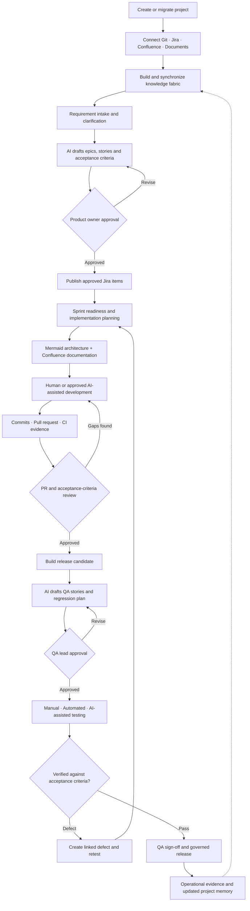
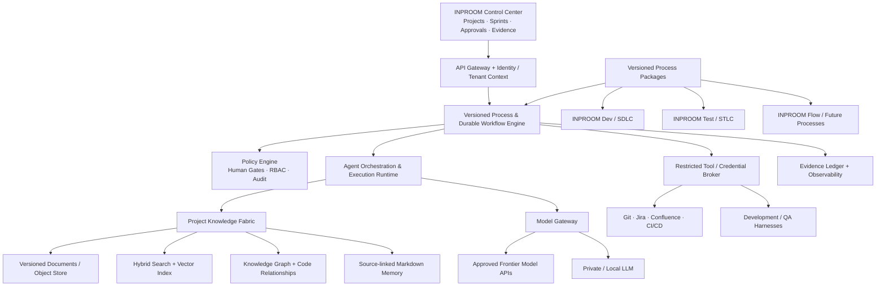
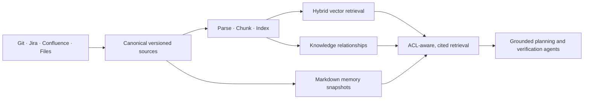
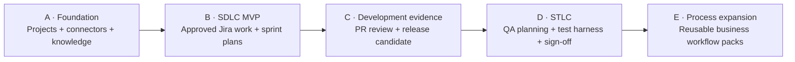

# INPROOM

### Intelligent Process Orchestration & Management

**AI-native lifecycle intelligence · Human-governed execution · Model-independent architecture**

**by ThinkHiveLabs**

*From Knowledge to Intelligent Execution.*

[Architecture](#platform-architecture) · [Lifecycle](#end-to-end-lifecycle) · [Capabilities](#platform-capabilities) · [Documentation](#documentation) · [Roadmap](#delivery-roadmap)

---

> [!IMPORTANT]
> **Project status: Design and documentation phase.** INPROOM is a proposed enterprise platform, not yet a production-ready application. The diagrams, technical stack, workflows and modules below describe the intended architecture; they are not claims of implemented features.

## Why INPROOM?

Enterprise delivery information is fragmented across requirements, project trackers, architecture documents, repositories, testing systems and release tools. INPROOM is designed to make that context available as a continuously synchronized, source-backed **project knowledge fabric**—and use it to orchestrate the complete process under configurable human approvals.

**Start with SDLC. Extend into STLC. Scale to any enterprise process.**

| **Understand** | **Plan** | **Execute** | **Verify** | **Learn** |
|:---:|:---:|:---:|:---:|:---:|
| Ingest project knowledge | Draft requirements and work items | Coordinate people and approved AI tools | Review code, testing and release evidence | Feed outcomes back into project memory |

## End-to-end lifecycle

A project can be **new** or **migrated from existing tools**. INPROOM is intended to retain evidence and traceability from the first requirement through QA sign-off and release outcomes.

**Approval-first by default:** draft stories, plans, page updates, PR-related changes, QA items and release actions are governed by project policies. AI suggestions do not become external system writes merely because a model generated them.

## Platform architecture

*Conceptual architecture; components and service boundaries may evolve during implementation. See the [detailed architecture and technology choices](docs/architecture/overview.md) and [editable diagram collection](docs/architecture/diagrams.md).*

## Platform capabilities

| Area | Intended behavior |
|---|---|
| **Project workspace** | Create new or migration projects; connect authorized source systems and define project-specific governance. |
| **Knowledge fabric** | Version originals, index code and documents, build graph relationships and vector/lexical retrieval, and generate source-linked Markdown memory snapshots. |
| **Requirements intelligence** | Convert requirements into proposed epics, Jira stories, acceptance criteria and dependencies; publish only after approval. |
| **Sprint intelligence** | Identify ambiguous items, impacted components, missing evidence, risks and implementation readiness. |
| **Architecture documentation** | Produce editable Mermaid diagrams and rendered visuals for reviewed Jira/Confluence updates. |
| **Development & PR verification** | Support developers or sandboxed AI assistance; compare actual PR diffs, checks and tests to approved expectations. |
| **Release & STLC** | Compose governed release candidates, propose QA work, select regression scope, capture real test results, defects and QA sign-off. |
| **Model gateway** | Route tasks to approved frontier models, customer-supplied API credentials or private/local LLMs through consistent contracts. |
| **Security & audit** | Tenant/source permissions, encrypted credentials, restricted tools, explicit approvals, append-only activity evidence and recovery. |

### Knowledge is more than a chatbot

The **canonical source and its provenance remain authoritative**. Embeddings, graph edges and Markdown memory are reconstructable projections—not an independent source of truth. For existing-project migration, inferred history must be distinguished from verified links.

## Model choice and execution safety

INPROOM is designed for customer-configurable model routing: approved cloud frontier APIs, **bring your own API key (BYOK)**, or private/local endpoints. A consumer chat subscription does not necessarily include API usage. Customer secrets must be encrypted, brokered at execution time and excluded from prompts, source indexes and logs.

The development and QA **harnesses are controlled tool-execution frameworks**, not inherently separate foundation models. AI may propose code changes or tests, but verification requires actual repository diffs, CI signals, executed checks and traceable evidence. No autonomous production deployment is enabled by default.

## Product family

| Package | Focus | Sequence |
|---|---|---|
| **INPROOM Core** | Process definitions, orchestration, knowledge, models, governance and integrations | Foundation |
| **INPROOM Dev** | Requirements → planning → implementation → PR → release candidate | First use case: SDLC |
| **INPROOM Test** | QA plans, tests, automation, defect loops and sign-off | Second use case: STLC |
| **INPROOM Flow** | Configurable enterprise workflows beyond software engineering | Future expansion |

## Reference technology stack

This is a **proposed stack**, not a declaration that these services are deployed.

| Layer | Reference options |
|---|---|
| Web control center | React · TypeScript · Next.js |
| API and service contracts | Python · FastAPI · Pydantic |
| Workflow orchestration | Temporal (to evaluate) |
| Relational metadata and retrieval | PostgreSQL · pgvector; graph projection as needed |
| Canonical documents and evidence | S3-compatible object store / MinIO |
| Model access | Provider-neutral gateway · frontier API adapters · vLLM/Ollama |
| Identity and secrets | OIDC/Keycloak or managed IdP · KMS-backed credential broker |
| Execution | Restricted workers / isolated code and test sandboxes |
| Monitoring | OpenTelemetry · Prometheus · Grafana |
| Deployment | Containers; SaaS, dedicated cloud, hybrid or on-prem options |

Technical decisions and trade-offs are tracked in the [architecture decision register](docs/development/decisions.md).

## Delivery roadmap

The immediate MVP proof is **one real project** whose source documents and repositories can be indexed, whose requirements become **approved** Jira work items, and whose sprint plans are grounded in retrievable evidence.

See the [delivery roadmap and acceptance gates](docs/development/roadmap.md). There is no committed release schedule until the implementation plan is reviewed.

## Development backlog and Jira planning

The [INPROOM Jira planning package](docs/planning/README.md) defines **14 epics and 65 developer-ready stories**, with implementation steps, expected outcomes, acceptance criteria, functional verification and negative/security/recovery tests.

- [Full implementation backlog](docs/planning/implementation-backlog.md)
- [Epic CSV](docs/planning/jira-import-epics.csv) · [Story CSV](docs/planning/jira-import-stories.csv)
- [Jira import and Epic → Story mapping guide](docs/planning/jira-import-guide.md)

**Important:** **Published to the INPROOM Jira project:** 14 epics and 65 stories, with verified Epic → Story relationships. [Browse the Jira project](https://aanaruna78.atlassian.net/jira/software/projects/INPROOM/boards/2) · [Issue key mapping](docs/planning/jira-key-map.md). Do not reimport the CSVs.

## UI / UX design concepts

> **UI/UX design update (November 2026):** [Premium Experience System V2](docs/ux/experience-system-v2.md) defines the current design direction, component behavior, accessibility, interaction quality gates and original [V2 SVG concepts](docs/ux/visuals-v2/README.md). The earlier design files remain for historical reference. [Confluence review page](https://aanaruna78.atlassian.net/wiki/spaces/INPROOM/pages/1441793).

INPROOM now has an early **experience design package** for product review, with role-based user journeys, approval patterns, screen requirements and visual concepts. These are **proposed interfaces**, not implemented application screens.

| Review artifact | Open |
|---|---|
| UX blueprint and screen requirements | [UX / Product Experience Blueprint](docs/ux/README.md) |
| Visual concepts | [Four screen mockups](docs/ux/visuals/README.md) |
| Click-through review | [Self-contained HTML prototype](docs/ux/prototype/index.html) — download/open locally to switch screens |
| Information architecture | [Screen map and milestone plan](docs/ux/screen-map.md) |
| Design tokens | [Editable color / typography / layout tokens](docs/ux/tokens.json) |

The SVG visuals can be imported into Figma as editable vector artwork. A native Figma design file has **not** been created yet.

## Documentation

| Start here | Description |
|---|---|
| [High-level architecture](docs/architecture/overview.md) | Services, reference technology stack, deployment choices and data boundaries |
| [Complete lifecycle specification](docs/lifecycle/complete-lifecycle.md) | Fourteen controlled stages from onboarding through QA sign-off and feedback |
| [SDLC use cases](docs/use-cases/sdlc.md) | Project migration, requirements, sprint intelligence, code and PR verification |
| [STLC use cases](docs/use-cases/stlc.md) | QA stories, test plans, manual/automated testing, defects and sign-off |
| [Mermaid architecture diagrams](docs/architecture/diagrams.md) | Editable architecture, knowledge and execution flowcharts |
| [Development roadmap](docs/development/roadmap.md) | Epics, milestones and MVP exit criteria |
| [Architecture decisions](docs/development/decisions.md) | Proposed decisions and items requiring validation |

## Repository and contributor guidance

This repository holds the **INPROOM design baseline** and the start of the implementation. The development skeleton (FastAPI API, Next.js web, local Docker stack, CI) is runnable; product features are being delivered story by story from Jira.

**Run it locally:** `make doctor && make setup && make up && make migrate && make test` — see [local setup](docs/development/local-setup.md) and [contributing](CONTRIBUTING.md).

For any engineering contribution:

1. Keep requirements, architecture, diagrams and implementation contracts synchronized.
2. Propose changes with source links, expected behavior and test evidence.
3. Prefer pull requests and reviewer approval even when the repository permits direct pushes.
4. Never commit customer documents without authorization, private keys, tokens, `.env` credentials or sensitive data.
5. Preserve tenant boundaries, source-level ACLs, approval records and auditable external writes.

## Vision

**INPROOM is not intended to replace Git, Jira, Confluence or existing test tools.** It is the intelligent, human-governed layer that connects them—understands the project, proposes the next action, verifies the evidence and continuously improves process context.

**INPROOM · Intelligent Process Orchestration & Management**  
*by ThinkHiveLabs*

