# Configurable AI Process Lifecycle Platform - Mermaid Architecture Sources

Version 0.1 | 19 November 2026

The diagrams below are editable Mermaid sources. The companion PDF embeds visually rendered equivalents of these same graph structures.

## Reference architecture - process control plane

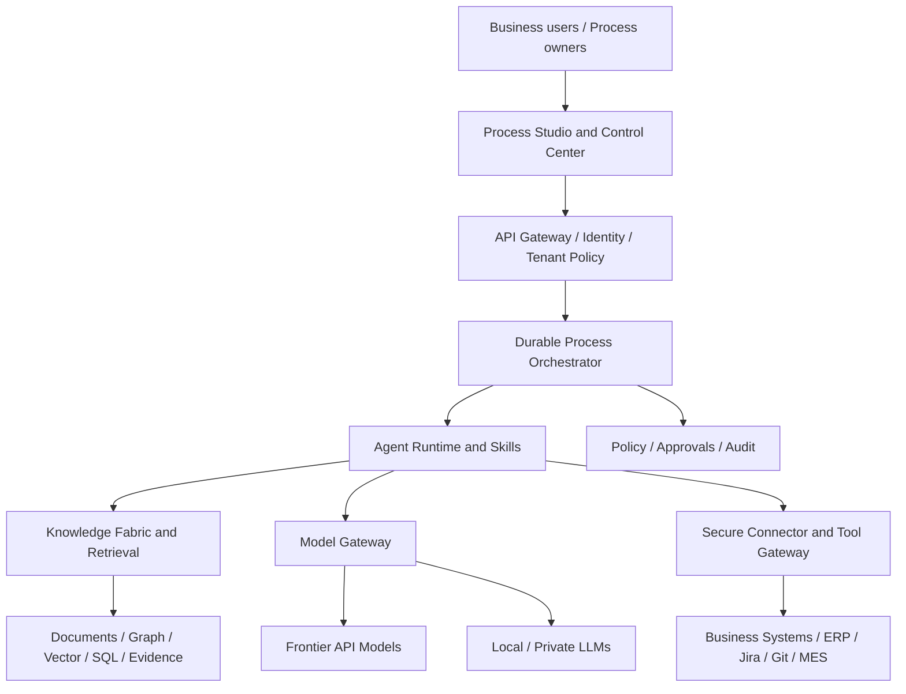

## Configuration model - process as a product

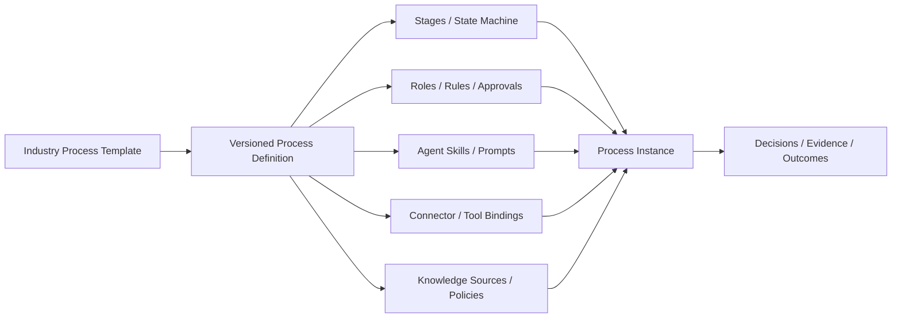

## Document ingestion and governed learning

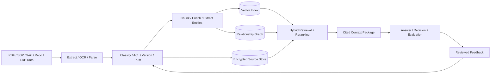

## Policy-driven cloud and local model routing

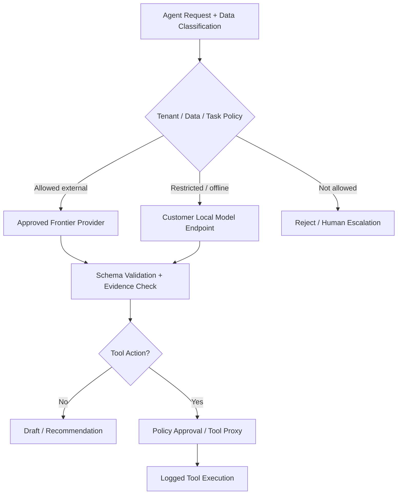

## Human-governed process execution

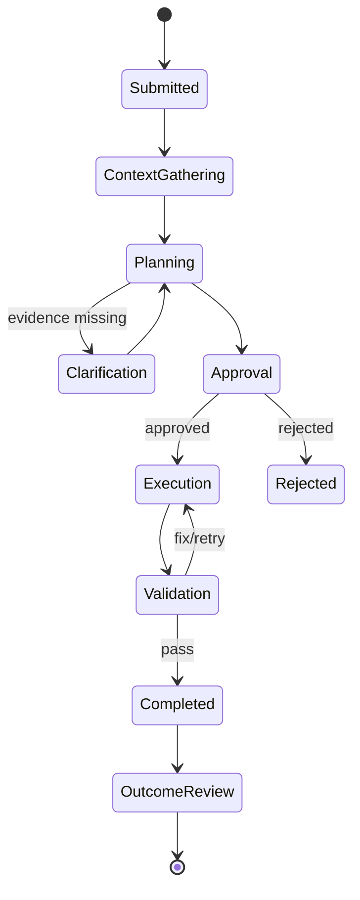

## Security boundaries and action enforcement

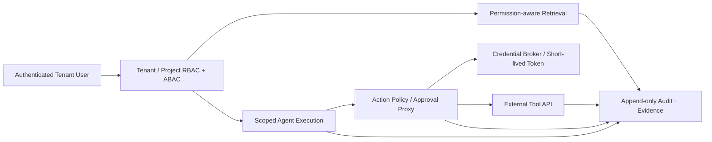

## SaaS, dedicated and on-prem deployment variants

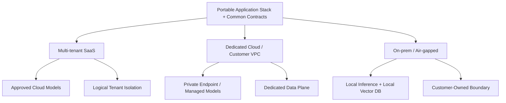

## MVP delivery architecture and sequence

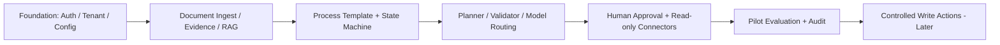

## SDLC first process package — staged delivery

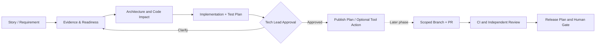

## STLC second process package — QA lifecycle

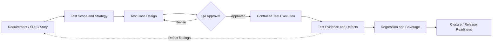

## Cross-package linkage — evidence traceability

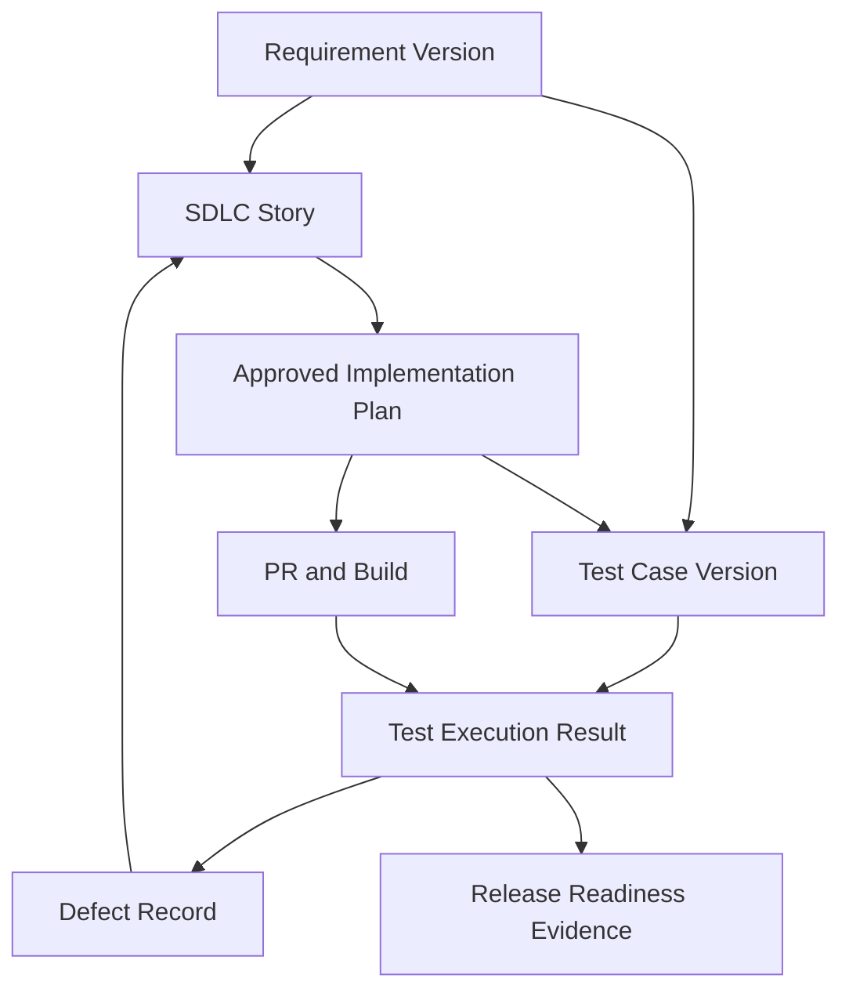

## Core data relationships

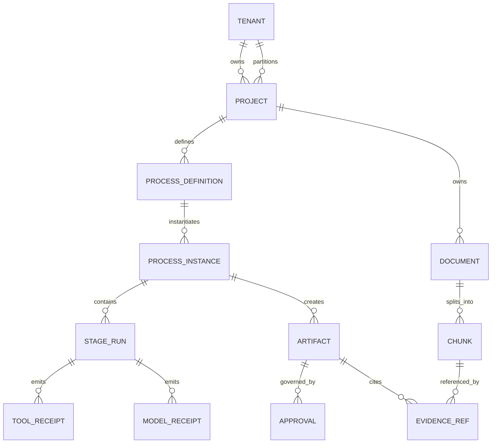

The figures embedded in the companion DOCX/PDF are rendered architecture visuals. These Mermaid sources are the editable canonical diagram definitions for later revisions, including the SDLC/STLC diagrams added in v1.
