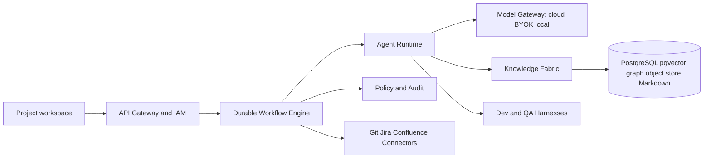
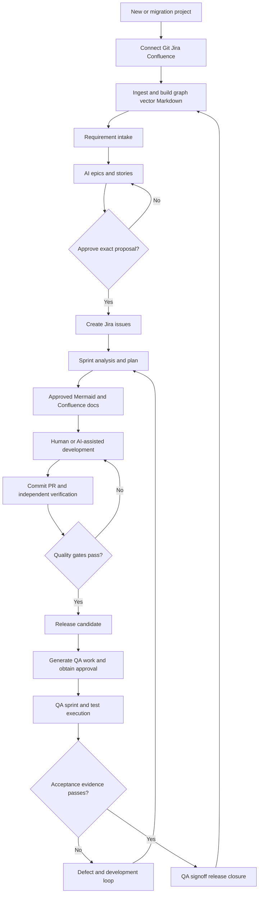
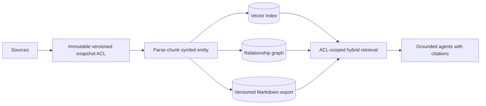
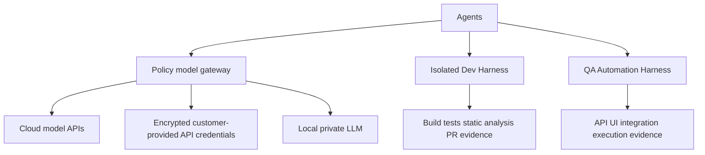
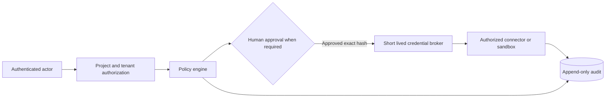
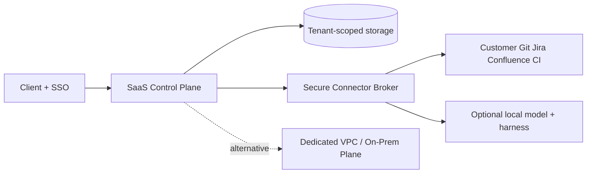
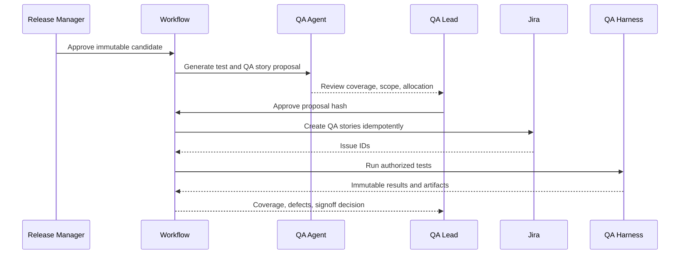
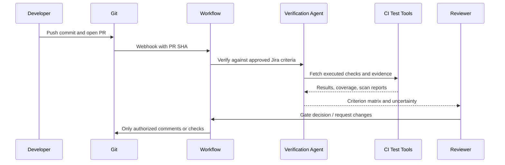

# AI Process Lifecycle Platform — Master Architecture Mermaid Sources v2.0

## High-level platform

## Lifecycle

## Knowledge

## Models and harnesses

## Security and approvals

## SaaS / on-prem deployment

## QA handoff

## PR verification

