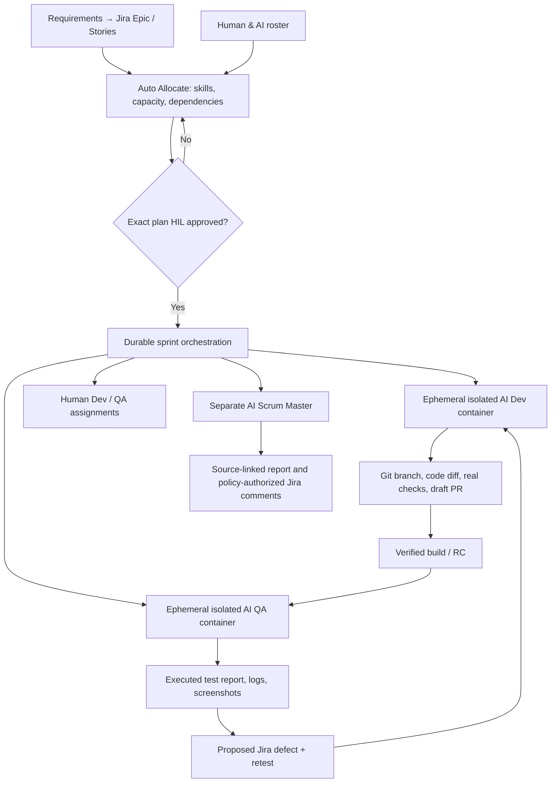

# INPROOM — Hybrid Human & AI Delivery Architecture

**Design specification, not implemented.** 26 November 2026.  
**Epic:** [INPROOM-190](https://aanaruna78.atlassian.net/browse/INPROOM-190).

## Overview

A project owner configures human developers/QA by verified name and email, and AI developers/QA through tested provider-specific agent adapters (Claude Code, GPT/OpenAI-based, Gemini-based or another compatible supported adapter). A separate **AI Scrum Master** monitors an active sprint at a configurable **10:00 AM project-local default** on configured workdays. Requirements generate Jira Epics/Stories, and **Auto Allocate** drafts human+AI assignments, requires human-in-the-loop authorization and starts no tools without an approved policy-bound sprint plan.

**Important:** An adapter option is not an assertion that a particular provider's CLI, API, license or runtime is currently available. Validate integration and provider terms. This design does not authorize actual background tasks, production writes or AI jobs today.

## Project onboarding

1. Select NEW or MIGRATION and configure Git/Jira/Confluence.
2. **People:** Invite human Dev and QA users by name/email; connect to verified identities and optional Jira account IDs; assign scoped roles, skills, availability, capacity, calendar, time zone.
3. **AI agents:** Select validated developer/QA adapters, provider/model, version, allowed repo/ref/path, container profile, permitted tools, cost/token/time budgets, credential *reference*, team role and readiness check. Tokens remain in secret broker.
4. **Sprint:** Default 14 calendar days (two weeks); user sets start, length, working days, holidays, capacity, IANA time zone and Jira sprint association.
5. **Scrum Master:** Separate opt-in service; project-local 10:00 on configured workdays by default, schedule/time zone adjustable; Jira comments **draft-only by default**. Explicit policy required for auto-posting.
6. Save versioned roster and settings; wait for HIL approval before any write-enabled agent runs.

### Roster and execution contract

`team_member = {id, project_id, kind: HUMAN|AI, discipline: DEV|QA|SCRUM, display_name, verified_identity?, email?, adapter_id?, capabilities, status, role_scope, capacity, schedule, runner_profile?, credential_ref?, limits, revision}`

Only verified humans gain real project membership. AI identities are separately attributed bot/service actors; never impersonate a person.

## Auto Allocate — proposed → approved → active

Trigger: Requirements Gathering has approved work-items and Jira keys or approved drafts, with source snapshot available.

1. Snapshot backlog, ready-to-work state, dependencies, estimates, priority, team skills/capacity/leave, working days, AI capabilities/quotas and budget.
2. Propose per-story human or AI candidate, estimated effort, conflicts, confidence, reason and QA review owner. Unestimated/blocked work remains flagged rather than silently committed.
3. Render editable allocation table with exact target Jira sprint, planned dates, workload/cost, create/update/assign counts, source version and overrides.
4. Human reviewer explicitly approves **the exact version/hash** and then **Kick Start Sprint**. Changes to roster, Jira issues, source revision, policies or sprint dates invalidate stale approval.
5. Durable worker updates Jira assignments/sprint membership and queues only permitted tasks with stable idempotency keys. Collect item-level receipts and recovery for partial failures; no blind retry that duplicates actions.

**States:** Draft → Proposed → Awaiting HIL → Approved → Activating → Active / Partially Active / Blocked / Canceled.

## Agent runtime architecture

### Preconfigured Dev & QA containers

Versioned, signed OCI images; ephemeral per project/run; rootless/unprivileged; scoped worktrees and test data; pinned base Git commit, allowlisted network and repository paths; no Docker host socket; short-lived brokered credentials; CPU/RAM/time/concurrency/token limits; artifact hash, cleanup, logs, run audit and cancellation. Sandbox is a security boundary, **not** a blanket license to bypass provider or tenant security.

**Dev inputs:** approved Jira issue, plan, exact commit/branch, allowed paths and tools, adapter version, test requirements, budget.  
**Dev output:** changed code, executed checks, linked branch/draft PR, run receipt, actual CI status. No merge by default.

**QA inputs:** approved build/RC, tests, environment, data policy, allowed test runner.  
**QA output:** actual runner results, logs/screenshots/artifact hashes, pass/fail/inconclusive per case, proposed linked bugs. No invented passes or auto QA sign-off.

## Separate AI Scrum Master service

**Service is optional and not automatically running until product implementation and project enablement.**

IANA time zone per project (e.g. Asia/Kolkata, Europe/Zurich); default 10:00 AM local, working days only by default, editable weekday/time/holiday exceptions. DST handling distinguishes skipped/ambiguous local wall times and guarantees idempotency by project + scheduled local date + schedule version. On a run:
1. Read actual sprint/Jira status, issue changes, blockers, source freshness, PR/CI, QA test evidence, unapproved agent jobs.
2. Produce cited daily sprint digest: goal progress, WIP/blocked issues, risky dependencies, suggested actions and evidence gaps. Clearly mark missing updates.
3. Draft concise, attributable Jira issue comments; optional auto-post only under approved bot policy, target scopes and rate limits; record comment IDs and retries.
4. Prepare or assist Scrum ceremonies: standup agenda, planning capacity, refinement, sprint review/demo, retrospective observations; do **not** claim human attendance or ceremonies happened.
5. Notify configured humans, show last/next run and pause/retry/opt-out controls.

**Report schema:** `{project,sprint,time_zone,scheduled_at,source_snapshot,issue_observations,blockers,risks,comment_drafts,posted_comment_ids,ceremony_agendas,run_receipt,audit_id}`.

## UI

New **Delivery Team** step in Create/Migrate Project; roster tabs **People | AI Developers | AI QA | Scrum Master**; readiness tests; scoped credentials and container profiles; visible **Auto Allocate** button in requirements/sprint. Allocate-preview table and approval drawer; two-week calendar editable. In project control center: human/AI assignments, agent runs, real PR/check outcomes, QA evidence/defects, Scrum last/next run and comments policy.

See [Hybrid Team screen design](../ux/v2.1/screens/ux-18-hybrid-delivery-team.svg) and [workflow diagram](visuals/07-hybrid-delivery-orchestration.svg).

## End-to-end functional verification

| Test | Expected verified result |
|---|---|
| F01 Human Dev/QA invite by name/email | Role-scoped invite; verified identity before access; duplicate/revoke safe |
| F02 Configure multiple provider adapters | Only installed/authorized/compatible options ready; no plaintext secrets |
| F03 Mixed Auto Allocate, blocked dependencies | Reasoned draft; no Jira writes or runs before HIL |
| F04 Approve or reject changed allocation | Exact version bound; stale approval cannot activate |
| F05 Kick off default two-week sprint | Jira linked, no duplicate assignments/jobs on retry |
| F06 AI Dev runs in container | Actual code diff, checks and draft PR linked to Jira key |
| F07 AI QA runs in container | Actual build/test evidence, failure and proposed Jira defect |
| F08 Scrum review at 10:00 local | One report per eligible project-local scheduled date |
| F09 Change timezone/working days | DST/holiday-respecting schedule and accurate next-run display |
| F10 Authorized bot comments | Target Jira issue and actor identified; unapproved comment blocked |
| F11 Revoke credential / crash container | Terminate safely; no secret leak, duplicate PR or false success |
| F12 Existing Jira sprint/team migration | Reuse keys/actors and flag conflicts; do not overwrite people |

Coverage: unit/contract, connector integration, UI E2E, tenant/project authorization, policy and approval replay, secret and sandbox isolation, actual test-run evidence, scheduling across IANA/DST/holiday and load/concurrency tests.

## Jira story map

| Jira | Work |
|---|---|
| [INPROOM-191](https://aanaruna78.atlassian.net/browse/INPROOM-191) | Human Dev / QA onboarding |
| [INPROOM-192](https://aanaruna78.atlassian.net/browse/INPROOM-192) | AI developer adapter registry |
| [INPROOM-193](https://aanaruna78.atlassian.net/browse/INPROOM-193) | AI QA agent onboarding |
| [INPROOM-194](https://aanaruna78.atlassian.net/browse/INPROOM-194) | Isolated Dev / QA containers |
| [INPROOM-195](https://aanaruna78.atlassian.net/browse/INPROOM-195) | AI development → draft PR |
| [INPROOM-196](https://aanaruna78.atlassian.net/browse/INPROOM-196) | AI QA → actual evidence and bugs |
| [INPROOM-197](https://aanaruna78.atlassian.net/browse/INPROOM-197) | Auto Allocate engine |
| [INPROOM-198](https://aanaruna78.atlassian.net/browse/INPROOM-198) | HIL review and sprint activation |
| [INPROOM-199](https://aanaruna78.atlassian.net/browse/INPROOM-199) | Configurable sprint calendar |
| [INPROOM-200](https://aanaruna78.atlassian.net/browse/INPROOM-200) | Independent Scrum Master scheduler |
| [INPROOM-201](https://aanaruna78.atlassian.net/browse/INPROOM-201) | Scrum Jira comments and ceremonies |
| [INPROOM-202](https://aanaruna78.atlassian.net/browse/INPROOM-202) | Hybrid Team Control Center |

## Dependencies

E01 project and permissions, E02 Jira/Git connectors, E05 model gateway, E06 approval and durable workflows, E07 requirements, E08 sprint intelligence, E09 Dev/PR, E12 QA/evidence and E14 UX. This epic composes those existing services; it should not reimplement them.
