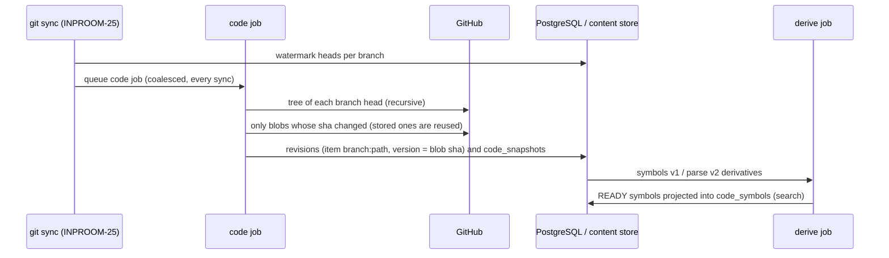

# Repository code index (INPROOM-29)

INPROOM indexes the code of every **selected branch** of every **ACTIVE** selected repository:
- **files**, as source revisions keyed by their git blob sha;
- **symbols** (definitions and imports, with lines);
- **ownership**, from CODEOWNERS.

Code search returns **citations**: repository, branch, commit, path, symbol and lines, plus the blob sha and a commit-pinned permalink.

## How indexing runs

- **One snapshot per branch and commit** (`code_snapshots`). It is **COMPLETE** when the full tree was read and every file fetched. Otherwise it is **PARTIAL**: the tree was truncated, there were more than 20,000 files, or some files were unreadable.
- **Only a COMPLETE snapshot removes files** that are gone from the branch, and reports renames (the same blob at a new path). A PARTIAL snapshot removes nothing.
- **Incremental:** unchanged blob shas are never downloaded. Blobs the repository already holds (renames, copies) are read from the content store.
- **Batched:** at most **500 downloads per run**. The job re-queues itself, and each run recomputes what is left, so retries and restarts are idempotent.
- **What triggers a re-index:** a branch head moves (webhook or schedule) → git sync → code job. An already-indexed commit costs one database lookup.

## What is indexed

| Indexed | Producer |
|---|---|
| `.py` | `symbols@1` via Python `ast` (exact) |
| `.js .jsx .mjs .cjs .ts .tsx` | `symbols@1` scanner (`method: "scan"`) |
| `.go`, `.java` | `symbols@1` scanner |
| `.md .markdown .txt` | `parse@2` (documents, anchors) |

Skipped files are listed on the snapshot with a reason:

| Reason | Examples |
|---|---|
| vendored or generated directory | `node_modules/`, `vendor/`, `third_party/`, `dist/`, `build/`, `.venv/` |
| generated file | `*.min.js`, `*_pb2.py`, `*.pb.go`, lock files (`package-lock.json`, `poetry.lock`, `go.sum`, …) |
| symbolic link / submodule | not followed |
| larger than 1000000 bytes | per-file cap |
| Git LFS pointer | the file is stored outside the repository |
| binary content / not UTF-8 text | detected after download; the verdict is remembered by blob sha |
| not accessible to the connection | the token cannot read the blob; the snapshot becomes PARTIAL and the file is retried at the next commit |
| over the 20000-file limit of a snapshot | the snapshot becomes PARTIAL |

Other file types (images, configuration) are not code and are not listed.

## Symbols

- **Each definition** has `kind` (function, method, constructor, class, interface, type, enum, record, struct, constant, annotation), `name`, `container` (enclosing class, or the Go receiver type), `signature` and `line_start`/`line_end`.
- **Imports** are listed with their line.
- **Failures** (in the error catalog) appear on the file's derivative. Other files are unaffected.
  - `CODE_SYNTAX_ERROR`: Python that doesn't parse; the message has the line.
  - `PARSE_LIMIT_EXCEEDED`: more than 20,000 definitions.
  - `PARSE_MALFORMED`.
- **Warnings:** lines over 5,000 characters (minified code) aren't scanned (`LONG_LINES_NOT_SCANNED`).
- **Scanner limits:** the JS/TS, Go and Java scanners mask comments and strings and track braces. They handle ordinary code well, but they aren't full parsers. A later `symbols@2` (tree-sitter) can replace them: invalidate producer `symbols` to rebuild.

## Ownership

`CODEOWNERS` is read from `.github/`, the repository root, then `docs/`, at the snapshot's commit, using GitHub's rules:
- **the last match wins**;
- `/` anchors a pattern to the root; a trailing `/` matches a directory's contents;
- `*` stays within a path segment and `**` crosses segments; `docs/*` covers direct files only;
- **a pattern without owners unsets ownership.**

Lines GitHub would ignore (negation, `[ ]`, invalid owners) are reported in `codeowners.errors` on the snapshot API.

## APIs (project.read)

| Route | Returns |
|---|---|
| `GET /v1/projects/{id}/code/search?q=&kind=&language=&repository=&branch=&cursor=` | Symbol hits ranked exact > prefix > contains (case-insensitive). Each hit has `citation` {repository, branch, commit, path, line_start, line_end, blob_sha, permalink}, `owners`, `behind`, `snapshot_status`, and `item` (for the content API). |
| `GET /v1/projects/{id}/code/snapshots` | Per repository and branch: `head_commit`, `indexed_commit`, `behind`, `indexing`, `status`, `truncated`, counts, skipped paths, renames, CODEOWNERS errors |
| `GET /v1/projects/{id}/code/files?repository=&branch=&path=` | One file's definitions, imports, owners and citation. 404 `CODE_NOT_FOUND` for unselected branches; 409 `CONTENT_WITHHELD` when the repository is paused or the file is withheld; 409 `NOT_INDEXED` (with `parse_status` and `failure`) when there are no symbols yet |

**Which commit a citation names (INPROOM-177):** each file carries `verified_ref`, the newest commit at which its current content was confirmed.
- The code job sets it for every file it records or finds unchanged.
- A citation names that commit, so the commit always contains exactly the cited content:
  - mid-batch, new files cite the new commit and not-yet-rechecked files cite their earlier commit;
  - in a PARTIAL snapshot, files the cut tree omitted keep their earlier commit.
- **`behind: true`** means the branch head has moved past that commit.
- **Permalinks** URL-encode the path (`#`, `?`, `%`, spaces, Unicode), keeping `/` and the `#L..` line fragment (INPROOM-181).

**Owners (INPROOM-180)** come from CODEOWNERS **at the commit the citation names**. Each snapshot records its commit's CODEOWNERS on its first run.

**Rejected new content (INPROOM-177):** a file whose new content can't be indexed (it became binary, an LFS pointer, or too large) is **withheld** (EXCLUDED, with the reason and commit). It is never left as stale code cited at a commit that doesn't contain it. Its previous content returns once the path holds indexable content again.

**Rollbacks (INPROOM-178):** a branch's files reflect its most recently **finished** snapshot. If the head returns to a commit indexed before (a rollback or force-push), that snapshot is re-activated and the files are restored. Stored blobs are reused and nothing is downloaded again.

**Withholding:**
- **Paused or excluded repository** (access lost, deleted branch, connection revoked, user exclusion): it drops out of search, and its files are withheld.
- **Branch no longer selected (INPROOM-179):** it drops out of search, files and content at once (`CODE_NOT_FOUND` / `SOURCE_BRANCH_NOT_SELECTED`). The next code job marks its files EXCLUDED and its snapshots RETIRED. Reselecting re-activates it from stored blobs.
- **Removed repository:** its items become DELETED at the next retention purge.

## Troubleshooting

| Symptom | Check |
|---|---|
| `behind: true` for a long time | `GET /sources/jobs`: is a `code` job failing (rate limit, outage)? Are the worker and scheduler running? |
| A file is missing from search | `GET /code/snapshots` → `skipped` for its path; `GET /content/git/{source}/{branch}:{path}/revisions/{n}/derivatives` for a FAILED `symbols` derivative |
| A snapshot stays PARTIAL | `truncated` (huge tree), the file cap, or `not accessible` paths: grant the token read access, or split the repository |
| Wrong owners | `codeowners.errors` on the snapshot; remember that the last match wins |
| A deleted branch | The repository is paused (INPROOM-26); fix the selected branches on the Sources page. The last good index is kept. |

Recovery is automatic: outages and rate limits retry with backoff and resume. A crash re-runs and records each file at most once.
