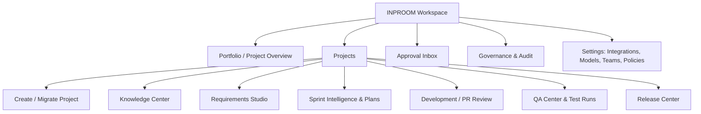

# INPROOM — UX / Product Experience Blueprint

**Version:** 0.1 concept • **Status:** Proposed design (not implemented) • **Product:** INPROOM by ThinkHiveLabs

## 1. Experience vision

INPROOM should feel like a **project intelligence cockpit**, not a chatbot with an attached issue tracker. Each decision must expose **what the AI proposes, why, its source evidence, its affected external systems, and who can approve it**.

**Core UX rules**
1. **Context first:** every screen shows tenant / workspace / project / active process / source freshness.
2. **Human agency:** proposal → diff preview → approvals → write receipt. Never surprise-write to Jira, Confluence or Git.
3. **Evidence adjacent to action:** citations, source version, uncertainty and affected files/issues appear beside the proposal.
4. **Progressive disclosure:** portfolio overview first; technical detail available without drowning managers in raw logs.
5. **State clarity:** draft, awaiting approval, approved, executing, completed, blocked, failed, stale are visibly distinct.
6. **Model transparency:** show selected provider, policy, budget and whether content may leave customer infrastructure.
7. **Recoverability:** all long-running jobs have event timelines, retry options, and safe human takeover.
8. **One source of truth:** source content remains authoritative; graph, vector and Markdown snapshots are searchable projections.
9. **Never fake certainty:** “Not enough evidence” is a valid and prominent agent outcome.
10. **Keyboard/accessibility:** full keyboard support, labeled controls, responsive layouts and WCAG 2.2 AA as target.

## 2. Primary users, jobs, and permissions

| Persona | Job to be done | Home | Sensitive actions |
|---|---|---|---|
| Workspace admin | Set up tenant, projects, integrations, model policies, access | Admin & Integrations | Credentials, membership, policies |
| Product owner / BA | Turn requirements into approved epics/stories, resolve ambiguity | Requirements Studio | Jira publication |
| Architect / tech lead | Assess impact, review implementation and architecture designs | Sprint / Planning Workspace | Plan approval, Confluence write |
| Developer | Understand assigned work, execute implementation, link PR evidence | My Work / PR Review | Branch/PR tool actions |
| QA lead | Approve QA backlog, allocate and assess release readiness | QA Center | QA Jira publish, sign-off |
| Tester | Run manual/automated tests and record proof against criteria | Test Runs | Test status / defect transitions |
| Release manager | Build release evidence, gate deployment | Releases | Environment actions |
| Security / compliance | Audit policies, model routing and action logs | Governance | Policy / export permissions |
| Engineering manager | Monitor health, throughput, risks and decisions | Portfolio Overview | Read-only unless role expanded |

### Access characteristics
- Scope every view and search to tenant/project/source permissions.
- Provide a **read-only demo mode** for showing concepts without external writes.
- Surface the full impact of an approval (e.g., “Create 1 Epic + 6 Stories in Jira”).
- Preserve pending approvals when a user switches pages or loses connectivity.

## 3. Information architecture

### Primary navigation
**Global:** workspace switcher, global search, notifications, approvals, account.  
**Project:** Overview · Knowledge · Requirements · Sprint · Development · QA · Releases.  
**Utilities:** Integrations · AI Models · Governance · Audit.  
**Persistent contextual drawer:** source evidence, linked Jira/Git/Confluence objects, run log, and review comments.

## 4. Screen inventory and detailed requirements

| ID | Screen | High-value UI | Primary CTA / guard |
|---|---|---|---|
| UX-01 | Portfolio overview | project health, active runs, blocked decisions, stale sources, workload | Open a project |
| UX-02 | Create / migrate wizard | project type, connector scopes, import preview, graph/index readiness, model + policy defaults | **Create project** only after scope review |
| UX-03 | Integration Hub | Git/Jira/Confluence status, sync freshness, webhook health, permission scope, reconnect | Connect/reconnect; show source authorization |
| UX-04 | Knowledge Center | source explorer, hybrid search, graph relationships, Markdown memory snapshots, source version | Inspect source, reindex with warning |
| UX-05 | Requirement Studio | intake editor, sources, ambiguity panel, epic/story tree, acceptance criteria, change preview | Submit proposal, approve exact version |
| UX-06 | Approval Inbox | pending approvals with risk, target system, approver, changed fields, diff, reason | Approve/reject/request changes |
| UX-07 | Sprint Intelligence | sprint board, story readiness, blockers, affected modules, risk, plan | Review proposed Jira/Confluence edits |
| UX-08 | Architecture & Planning | Mermaid editor + rendered preview, version diff, linked sources, publish target | Publish after permission and version checks |
| UX-09 | PR Verification | requirement-to-diff comparison, changed files, CI/test evidence, criterion verdict | Accept review / request developer fix |
| UX-10 | Release Candidate | included stories/PRs, readiness score, artifact hashes, controls | Submit RC for QA |
| UX-11 | QA Center | AI-suggested QA stories, coverage matrix, test allocation, defect loop | Approve QA creation/allocation |
| UX-12 | Test Runs | criterion, expected/actual, test evidence, manual/automation modality | Record evidence; sign-off separately |
| UX-13 | Model & Harness Settings | cloud/local model adapters, BYOK masked tokens, data policy, budgets, test sandbox | Test connection / save with KMS |
| UX-14 | Audit & Governance | who changed what, model/tool event timeline, approval history, exports | Scoped audit export |
| UX-15 | Help / Empty / Error states | first-run checklist, permission denied, stale data, model outage, partial sync | Guided recovery action |

## 5. Critical task flows

### UC-UX-01 Project onboarding
1. Select **New** or **Migrate**.
2. Configure Git/Jira/Confluence connectors with read-only scopes first.
3. Select allowed repositories, branches, Jira projects and Confluence spaces.
4. Preview documents and index volume; highlight skipped/denied sources.
5. Set model policy and data residency (cloud/private/local).
6. Define roles and approval thresholds; leave write operations off by default.
7. Start ingestion; show real progress per source, resumable jobs and the first knowledge completeness report.
8. Enter the project overview with “data fresh as of…” and known gaps.

### UC-UX-02 Requirements → approved Jira
1. Paste/upload requirements; show source citations and ambiguity flags.
2. AI drafts epic, child stories, acceptance criteria and dependencies.
3. Show a two-panel tree + detail editor, versioned revision history and editable suggested content.
4. Review the proposed Jira field changes, issue count and target project.
5. Require explicit approver for a bound proposal version; on approval, publish idempotently and display created Jira keys.
6. Distinguish partial publish failures from full success; allow safe retry or human reconciliation.

### UC-UX-03 Sprint → plan → Git / Confluence
1. Select sprint and a story, inspect readiness and current KB version.
2. Show implementation plan, affected modules, risks, test plan and editable Mermaid.
3. Require design review for architectural changes; show page version and Jira impact before publish.
4. After a human or permitted AI development cycle, inspect actual PR diff, CI, tests and source-linked acceptance criteria.
5. If incomplete, show **Inconclusive / Blocked**, not a false positive. Return to developer with actionable findings.

### UC-UX-04 Release candidate → QA
1. Create candidate from approved commits/builds.
2. Display AI-proposed test/QA stories and regression scope, with traceability and missing coverage highlighted.
3. QA lead approves QA issue creation and sprint allocation.
4. Tester or automation harness records actual results/evidence, defects, environment, version and timestamps.
5. QA lead signs off after verifying criterion-level evidence and policy exceptions.

## 6. Information design / reusable components

**Layout:** 240px collapsible navigation; 64px global header; responsive 12-column content grid; 360px optional context drawer. Wide tables should support saved filters and bulk selection. Desktop-first, tablet usable; essential approvals mobile-compatible.

**Components:** project switcher, scope/tenant breadcrumb, source freshness chip, confidence with rationale, approval status, diff preview, citation card, event timeline, relationship graph viewer, model route badge, run status, criterion matrix, Mermaid editor/preview, command palette, empty-state checklist, right-side evidence drawer.

**Proposal panel standard:** Title, operation type, affected target, source citations, before/after diff, risk, policy, exact proposal version, approver identity, expiry and primary/secondary actions.

**AI output standard:** Summary → evidence → proposed next steps → confidence/known unknowns → review actions. Avoid a wall of chat text.

**Error state standard:** Problem, whether anything was written, recovery path, trace ID, and who can resolve it. Never show a generic “Something went wrong” for irreversible actions.

## 7. Visual language (proposed)

| Token | Value | Application |
|---|---|---|
| Navy | `#142940` | sidebar / brand |
| Blue | `#3169E6` | primary actions |
| Teal | `#0D9488` | successful execution / evidence |
| Amber | `#D18A1B` | warnings and waiting |
| Red | `#C64747` | failure / blocked |
| Canvas | `#F6F8FC` | application background |
| Surface | `#FFFFFF` | panels and tables |
| Body text | `#243448` | readable copy |
| Muted | `#66758B` | metadata |
| Border | `#E4EAF2` | quiet separation |

Typography: Inter or accessible system sans, 14px default body, 18–24px workspace headings, 12–13px table metadata. Spacing: 4px base grid; card radius 12px; strong focus rings. Color must not be the only status cue.

**Status semantics:** Proposed (neutral), Awaiting Approval (amber), Approved (teal), Executing (blue), Failed / Blocked (red), Stale (amber with source age), Inconclusive (neutral with explanation). Do not use an “AI verified” green status without deterministic evidence.

## 8. Access, responsive behavior, and UX acceptance

- WCAG 2.2 AA design target; meet contrast, keyboard interaction, focus order, screen-reader semantics and accessible diagrams/tables.
- Approval actions require visible target, changed fields, scope, policy result and confirmation; show receipts after successful external write.
- All loading operations support cancel where safe, progress indicators, recoverable retries and eventual-consistency messaging.
- Tables support sorting, filtering, pagination, empty/error states, links and copyable IDs.
- Project/source switch updates all displayed evidence, not only the header.
- Large graphs show a focused subgraph by default; accessible list view available.
- No customer/provider secrets appear in UX logs or demo records.
- Mobile: responsive read-only summaries and approval inbox; full architecture editing remains desktop-first.

## 9. Usability evaluation tasks

1. New admin connects three systems, understands the scope and creates a project.
2. Product owner turns one ambiguous requirement into reviewed Jira epics and stories without unintended writes.
3. Tech lead finds exact evidence for one affected component and rejects an insufficient plan.
4. Developer identifies why an existing PR does not satisfy acceptance criterion AC-03.
5. QA lead creates scoped QA stories and locates all unmet test evidence.
6. Security reviewer reconstructs the approver/model/tool/source chain for an external update.

Success measures: task completion rate, time to correct decision, mistaken approval rate, evidence findability, perceived trust, accessibility audit, and recovery success on connector/model failures. Targets should be baselined through pilot testing rather than invented.

## 10. Artifacts and handoff

- [Visual mockups](visuals/README.md), editable SVG for Figma import.
- [Interactive concept prototype](prototype/index.html), self-contained HTML (no backend and no data access).
- [Feature / screen navigation map](screen-map.md).
- [Component tokens](tokens.json).
- [Mermaid diagrams](../architecture/diagrams.md).
- Architecture / low-level contracts: [platform HLA](../architecture/overview.md), [SDLC](../use-cases/sdlc.md), [STLC](../use-cases/stlc.md).

**Implementation note:** No Figma file has been created yet. SVG visuals are Figma-importable vectors; the prototype is a review artifact, not production software.
