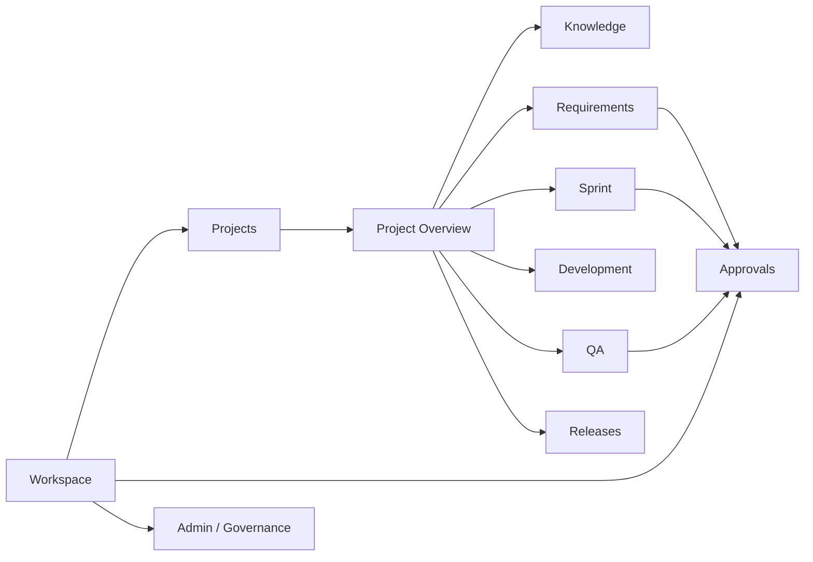

# INPROOM — Screen Map and UX Milestone Plan

## Global navigation

## Delivery slices

| Slice | Screens to implement | Completion checks |
|---|---|---|
| UX-A Foundation | Workspace, project overview, onboarding, integration hub, shell | Tenants and permissions; empty, sync and error states |
| UX-B Knowledge | Source explorer, search, graph view, memory snapshots | ACL-safe citations, source freshness and permission-aware filtering |
| UX-C SDLC | Requirement Studio, approvals, Sprint Intelligence, plan and Mermaid editor | Exact proposal diff + Jira / Confluence approval gates |
| UX-D Dev evidence | Development/PR verification, run log, release candidate | Real diff/CI checks and inconclusive cases visible |
| UX-E STLC | QA planning, test runs, defect loop and QA sign-off | Acceptance criteria mapped to executed evidence |
| UX-F Governance | Model/harness settings, policy editor, audit and advanced reporting | Masked keys, versioned policies, auditable write trail |

## Navigation conventions
- Left sidebar is stable across project context.
- Global approval inbox visible from any page; no deep links into inaccessible projects.
- In a project, the current KB snapshot/freshness and AI model selection are discoverable.
- All external links display the target system and open with clear context.
- Route names are suggested only; engineers must align with implemented framework/router.
