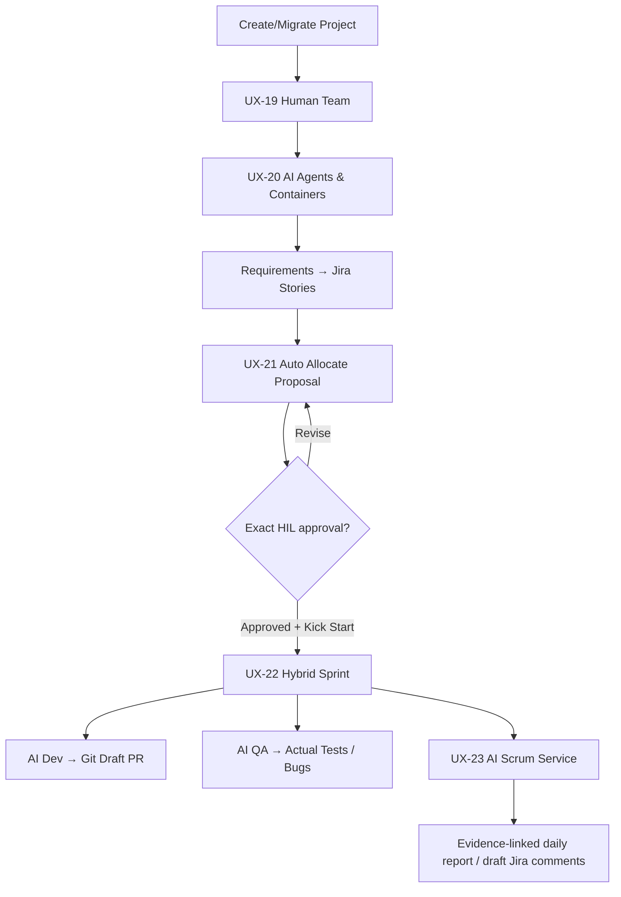

# INPROOM — Hybrid Delivery UX Extension (V2.2)

**Status:** Five additional visual concepts for Epic [INPROOM-190](https://aanaruna78.atlassian.net/browse/INPROOM-190). **These are design artifacts, not running screens or connected services.**

The existing [UX-18 hybrid delivery overview](../screens/ux-18-hybrid-delivery-team.svg) remains the entry point. This package adds five distinct, actionable screens.

| Screen | Purpose | Implementation parent |
|---|---|---|
| [UX-19 Human Team & Invitations](screens/ux-19-human-team-onboarding.svg) | Invite human Dev/QA members by name and email, validate identity, permission and capacity before allocating work. | [INPROOM-191](https://aanaruna78.atlassian.net/browse/INPROOM-191) |
| [UX-20 AI Agent & Container Setup](screens/ux-20-ai-agent-container-setup.svg) | Configure validated AI Dev/QA provider adapters and a restricted versioned container; do not assume unsupported providers work. | [INPROOM-192](https://aanaruna78.atlassian.net/browse/INPROOM-192) |
| [UX-21 Auto Allocate & HIL Approval](screens/ux-21-auto-allocation-review.svg) | Preview and override Auto Allocate recommendations, then require human approval of exact Jira assignments and runner scope. | [INPROOM-198](https://aanaruna78.atlassian.net/browse/INPROOM-198) |
| [UX-22 Hybrid Sprint Control Center](screens/ux-22-hybrid-sprint-control-center.svg) | Monitor human+AI execution through real Jira/Git/QA events, explain blockers, manage sprint changes without implicit approvals. | [INPROOM-202](https://aanaruna78.atlassian.net/browse/INPROOM-202) |
| [UX-23 AI Scrum Master & Ceremonies](screens/ux-23-ai-scrum-master-control.svg) | Configure a separate scheduled Scrum service, review factual progress reports and draft-only Jira comments by default. | [INPROOM-200](https://aanaruna78.atlassian.net/browse/INPROOM-200) |

## UX flow

## Shared interaction and design contract

- Reuse INPROOM V2 semantic tokens, premium application shell, responsive content, keyboard-accessible tables, dark/light mode and compact/comfortable density.
- Project type NEW/MIGRATION, tenant, Jira destination, source freshness and actor's effective permissions must remain visible.
- Human membership requires verified identity. Email is an invitation identifier, not sufficient authority.
- AI agents are installed/validated adapters with explicit capabilities; unsupported providers show "not configured", not false readiness.
- Container runtime uses approved image and credentials reference, scoped branch/workspace/network budgets. Display actual run state and results, not AI-generated success claims.
- Allocation begins as **draft**, shows proposed human/AI fit, dependencies, capacity, estimated cost, QA ownership and override. A reviewer approves the exact hash/version; a separate Kick Start action activates authorized work.
- Sprint defaults to 14 days, configurable before start; show Jira sprint sync and conflict states. A canceled or changed approval cannot launch agent jobs.
- Scrum service is **optional and separately enabled**; default is 10:00 AM in the project's IANA zone on configured working days, with edit/pause controls and next-run timestamp. Comments are drafts until policy allows posting.
- Every screen has loading/empty/permission denied/stale/conflict/network failure/partial success states and actual audit receipts when applicable.
- Do not invent production-ready work, real user identities, or measured performance from synthetic mockup data.

## Screen-level implementation and functional verification

### UX-19 — Human Team & Invitations

**Intent:** Invite human Dev/QA members by name and email, validate identity, permission and capacity before allocating work.

**Primary action:** Invite team member.

**Information layout**
- Left: Developers · QA Engineers · Tech Leads · Invitations · Availability calendar
- Main: Name / Role / Email · Asha Nair · Developer · Invited · Kiran Shah · QA Engineer · Active · Mina Rao · Developer · Active · Omar Ali · QA Lead · Active · Team capacity · Working calendar
- Inspector: Verified identity: required · Role and permission scope · Email invitation status · Skills and capacity (hrs/week) · Jira account mapping · Revoke / resend invite

**Implementation steps**
1. Build route in V2 shared shell with real project/role/permission context; add typed API contracts for this screen.
2. Bind the primary action to the appropriate proposed backend service. For any external action, show scope, exact proposed change, required authorization, version and outcome receipt.
3. Preserve unsaved user changes, keyboard focus and panel selection when switching modes or refreshing data.
4. Render all non-happy-path states: first run, unavailable provider/identity, empty team, denied role, stale data, partial Jira sync and failed job.
5. Instrument trace IDs, accessible status messages, audited operations and real CI/test evidence.

**Acceptance criteria**
- An authorized user completes the main task with accurate persisted state and no cross-project leakage.
- Manual edits cannot be silently overwritten by AI or sync.
- Any run/Jira write is held behind policy and correctly bound approval; duplicate submissions do not duplicate external effects.
- All configurations and user-facing reports show real source/identity/runner metadata and correct project-local schedule.
- The screen is usable at desktop/laptop/tablet widths with keyboard, screen reader, zoom and light/dark modes.

**Functional verification**
- Positive end-to-end main flow, negative input/permission and cross-tenant cases.
- Source or roster revision conflict and stale approval.
- Provider outage, container failure, Jira API timeout and retry with idempotency.
- Visual regression 1280/1440/1920/tablet, empty/long data, compact and comfortable, WCAG 2.2 AA accessibility target.
- Evidence from actual test execution, never inferred pass states.

**Source:** [Editable visual](screens/ux-19-human-team-onboarding.svg). **Parent:** INPROOM-191.

### UX-20 — AI Agent & Container Setup

**Intent:** Configure validated AI Dev/QA provider adapters and a restricted versioned container; do not assume unsupported providers work.

**Primary action:** Validate configuration.

**Information layout**
- Left: AI Developers · AI QA Agents · Installed adapters · Container templates · Run budgets
- Main: Agent / Provider / Readiness · Dev Agent A · Claude Code-type · Dev Agent B · GPT-type · Dev Agent C · Gemini-type · QA Agent A · Playwright runner · Runtime image and permitted Git scope
- Inspector: Adapter health: verification needed · Model and credential reference · Runner template: signed OCI image · Git path / network allowlist · Max concurrency and budget · Run read-only capability test

**Implementation steps**
1. Build route in V2 shared shell with real project/role/permission context; add typed API contracts for this screen.
2. Bind the primary action to the appropriate proposed backend service. For any external action, show scope, exact proposed change, required authorization, version and outcome receipt.
3. Preserve unsaved user changes, keyboard focus and panel selection when switching modes or refreshing data.
4. Render all non-happy-path states: first run, unavailable provider/identity, empty team, denied role, stale data, partial Jira sync and failed job.
5. Instrument trace IDs, accessible status messages, audited operations and real CI/test evidence.

**Acceptance criteria**
- An authorized user completes the main task with accurate persisted state and no cross-project leakage.
- Manual edits cannot be silently overwritten by AI or sync.
- Any run/Jira write is held behind policy and correctly bound approval; duplicate submissions do not duplicate external effects.
- All configurations and user-facing reports show real source/identity/runner metadata and correct project-local schedule.
- The screen is usable at desktop/laptop/tablet widths with keyboard, screen reader, zoom and light/dark modes.

**Functional verification**
- Positive end-to-end main flow, negative input/permission and cross-tenant cases.
- Source or roster revision conflict and stale approval.
- Provider outage, container failure, Jira API timeout and retry with idempotency.
- Visual regression 1280/1440/1920/tablet, empty/long data, compact and comfortable, WCAG 2.2 AA accessibility target.
- Evidence from actual test execution, never inferred pass states.

**Source:** [Editable visual](screens/ux-20-ai-agent-container-setup.svg). **Parent:** INPROOM-192.

### UX-21 — Auto Allocate & HIL Approval

**Intent:** Preview and override Auto Allocate recommendations, then require human approval of exact Jira assignments and runner scope.

**Primary action:** Submit allocation for approval.

**Information layout**
- Left: Selected Jira sprint · Ready Stories · Dependency blockers · Team skills and capacity · AI usage limits
- Main: Jira Story / Candidate / Fit · STORY-01 · Asha (Human Dev) · STORY-02 · Dev Agent A (AI) · STORY-03 · Kiran (Human QA) · STORY-04 · QA Agent A (AI) · Blocked Story · Unassigned
- Inspector: Draft allocation version: v3 · Jira assignments: 4 proposed · AI jobs: 2 (not started) · Capacity / cost warnings · Source snapshot & policy hash · Approve → Kick Start separately

**Implementation steps**
1. Build route in V2 shared shell with real project/role/permission context; add typed API contracts for this screen.
2. Bind the primary action to the appropriate proposed backend service. For any external action, show scope, exact proposed change, required authorization, version and outcome receipt.
3. Preserve unsaved user changes, keyboard focus and panel selection when switching modes or refreshing data.
4. Render all non-happy-path states: first run, unavailable provider/identity, empty team, denied role, stale data, partial Jira sync and failed job.
5. Instrument trace IDs, accessible status messages, audited operations and real CI/test evidence.

**Acceptance criteria**
- An authorized user completes the main task with accurate persisted state and no cross-project leakage.
- Manual edits cannot be silently overwritten by AI or sync.
- Any run/Jira write is held behind policy and correctly bound approval; duplicate submissions do not duplicate external effects.
- All configurations and user-facing reports show real source/identity/runner metadata and correct project-local schedule.
- The screen is usable at desktop/laptop/tablet widths with keyboard, screen reader, zoom and light/dark modes.

**Functional verification**
- Positive end-to-end main flow, negative input/permission and cross-tenant cases.
- Source or roster revision conflict and stale approval.
- Provider outage, container failure, Jira API timeout and retry with idempotency.
- Visual regression 1280/1440/1920/tablet, empty/long data, compact and comfortable, WCAG 2.2 AA accessibility target.
- Evidence from actual test execution, never inferred pass states.

**Source:** [Editable visual](screens/ux-21-auto-allocation-review.svg). **Parent:** INPROOM-198.

### UX-22 — Hybrid Sprint Control Center

**Intent:** Monitor human+AI execution through real Jira/Git/QA events, explain blockers, manage sprint changes without implicit approvals.

**Primary action:** Review sprint blockers.

**Information layout**
- Left: Sprint 04 · 14 calendar days · Sprint goal and dates · Assigned human work · Queued and active AI runs · Blockers and spillover
- Main: Issue / Owner / State · DEV-101 · Human Developer · In progress · DEV-103 · AI Developer · PR review · QA-42 · AI QA · Test running · QA-47 · Human QA · Needs evidence · DEV-110 · Blocked dependency
- Inspector: Linked Git PR / actual CI status · Container run state / audit · Executed QA test artifacts · Reported Jira bugs · Allocation conflicts and replan · Sprint report / human sign-off

**Implementation steps**
1. Build route in V2 shared shell with real project/role/permission context; add typed API contracts for this screen.
2. Bind the primary action to the appropriate proposed backend service. For any external action, show scope, exact proposed change, required authorization, version and outcome receipt.
3. Preserve unsaved user changes, keyboard focus and panel selection when switching modes or refreshing data.
4. Render all non-happy-path states: first run, unavailable provider/identity, empty team, denied role, stale data, partial Jira sync and failed job.
5. Instrument trace IDs, accessible status messages, audited operations and real CI/test evidence.

**Acceptance criteria**
- An authorized user completes the main task with accurate persisted state and no cross-project leakage.
- Manual edits cannot be silently overwritten by AI or sync.
- Any run/Jira write is held behind policy and correctly bound approval; duplicate submissions do not duplicate external effects.
- All configurations and user-facing reports show real source/identity/runner metadata and correct project-local schedule.
- The screen is usable at desktop/laptop/tablet widths with keyboard, screen reader, zoom and light/dark modes.

**Functional verification**
- Positive end-to-end main flow, negative input/permission and cross-tenant cases.
- Source or roster revision conflict and stale approval.
- Provider outage, container failure, Jira API timeout and retry with idempotency.
- Visual regression 1280/1440/1920/tablet, empty/long data, compact and comfortable, WCAG 2.2 AA accessibility target.
- Evidence from actual test execution, never inferred pass states.

**Source:** [Editable visual](screens/ux-22-hybrid-sprint-control-center.svg). **Parent:** INPROOM-202.

### UX-23 — AI Scrum Master & Ceremonies

**Intent:** Configure a separate scheduled Scrum service, review factual progress reports and draft-only Jira comments by default.

**Primary action:** Save schedule policy.

**Information layout**
- Left: Enable Scrum Master service · Project timezone: Asia/Kolkata · Review time: 10:00 AM local · Working days: Mon–Fri · Configure holidays and exceptions
- Main: Read-only project/sprint snapshot · Sprint progress and stale work · Blocked work and issue comments · Daily standup agenda and digest · Planning / Review / Retrospective
- Inspector: Jira comments: Draft for review · Bot identity and Jira scopes · Maximum comments/day · Last / next scheduled check · Local-day idempotency + DST · Approve drafts / Pause service

**Implementation steps**
1. Build route in V2 shared shell with real project/role/permission context; add typed API contracts for this screen.
2. Bind the primary action to the appropriate proposed backend service. For any external action, show scope, exact proposed change, required authorization, version and outcome receipt.
3. Preserve unsaved user changes, keyboard focus and panel selection when switching modes or refreshing data.
4. Render all non-happy-path states: first run, unavailable provider/identity, empty team, denied role, stale data, partial Jira sync and failed job.
5. Instrument trace IDs, accessible status messages, audited operations and real CI/test evidence.

**Acceptance criteria**
- An authorized user completes the main task with accurate persisted state and no cross-project leakage.
- Manual edits cannot be silently overwritten by AI or sync.
- Any run/Jira write is held behind policy and correctly bound approval; duplicate submissions do not duplicate external effects.
- All configurations and user-facing reports show real source/identity/runner metadata and correct project-local schedule.
- The screen is usable at desktop/laptop/tablet widths with keyboard, screen reader, zoom and light/dark modes.

**Functional verification**
- Positive end-to-end main flow, negative input/permission and cross-tenant cases.
- Source or roster revision conflict and stale approval.
- Provider outage, container failure, Jira API timeout and retry with idempotency.
- Visual regression 1280/1440/1920/tablet, empty/long data, compact and comfortable, WCAG 2.2 AA accessibility target.
- Evidence from actual test execution, never inferred pass states.

**Source:** [Editable visual](screens/ux-23-ai-scrum-master-control.svg). **Parent:** INPROOM-200.

## Engineering dependencies

INPROOM-191–202 govern human/agent onboarding, container orchestration, allocation, HIL, sprint and Scrum functionality; this design extension refines **UI behavior**, not a replacement for those service contracts. Existing [E15 architecture](../../../architecture/hybrid-delivery.md) is authoritative for security and execution boundaries.
