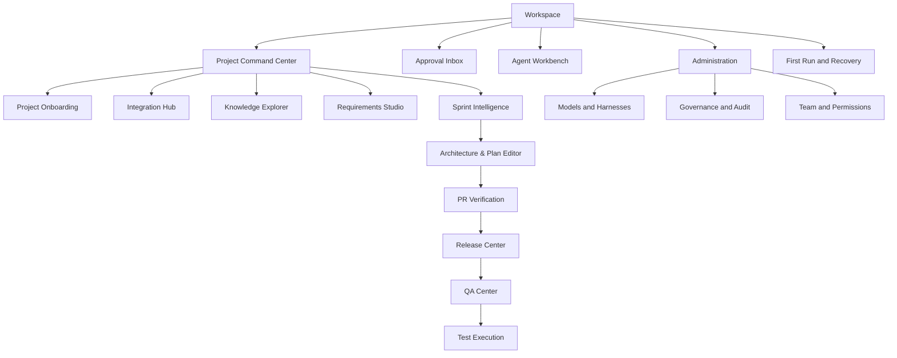

# INPROOM V2.1 — Complete Screen Library

**Design artifacts only — not implemented pages or tested user experiences.** Based on [V2 experience system](../experience-system-v2.md), [existing UX inventory](../README.md) and [V2 design tokens](../tokens-v2.json). This library deliberately uses synthetic data.

## Cross-cutting definition of done

- Respect project mode NEW/MIGRATION, tenant/role/source authorization, provenance, stale source revisions and human approval before tool writes.
- Shared shell, semantic tokens, accessible controls, keyboard/contrast/zoom audits, responsive layouts, dark/light and compact/comfortable modes.
- Backend-integrated state models with recoverable empty/slow/partial/stale/conflict/error cases; no fake test or execution success.
- Contract, integration, Playwright, security, keyboard and visual-regression proof linked to Jira work.
- Design mockups are illustrative; executable UI, real APIs and Figma-native components remain implementation tasks.

## IA

## Screen contracts

### UX-01: Project Command Center

**Outcome:** Decisions, risks, source freshness and current execution. **Primary action:** Review decisions. **Parent Jira story:** INPROOM-78.

**Layout and content:** Priority decisions; Approve 4 requirement proposals; Resolve 2 migrated Jira conflicts; Review 1 PR with missing tests; Confirm source connection scopes. Central work area: Execution stages; Requirements — review; Implementation — in progress; Verification — needs evidence; QA — not started; Release — gated. Inspector: Activity and evidence; Draft revised by product owner; Source revision reconciled; Build evidence attached; Approval action recorded.

**Detailed implementation requirements**
1. Implement this route using the V2 design tokens and shared application shell; persistent project/tenant context, navigation and role-aware actions.
2. Build the surface's primary objects with real, authorized APIs, typed loading/empty/ready/error responses and revision freshness.
3. Provide a keyboard-accessible focus order, visible action status, descriptive inline validation, unsaved-change handling and screen reader announcements.
4. On relevant AI, Jira, Git or Confluence actions, show source citations, before/after diff, exact destination and approval state before external writes; prevent duplicate execution.
5. Support 1440px desktop, 1280px laptop, tablet collapsed panels, semantic dark mode and compact/comfortable density. For narrow layouts, drawers replace simultaneous three panes; preserve active selection and draft.
6. Keep visual assets synthetic until application data is connected; emit audit/trace IDs for actionable errors.

**Expected verification**
- Main user journey: perform the stated action and observe the intended persisted or explicitly draft-only result.
- Negative: unauthorized scope, incomplete data, stale remote version, duplicate click, timeout and partial failure produce accurate user-facing states without corrupting data.
- Accessibility: keyboard-only navigation, accessible names, screen reader role/state announcements and WCAG 2.2 AA audit.
- Responsive: visual regression at 1280/1440/1920 and tablet, both themes, density modes, 200% zoom, long labels and empty/loading/conflict states.
- Evidence: automated unit/contract/E2E tests, real API receipts where appropriate, PR/CI evidence and screenshots. No invented pass metrics.

**Design preview:** [Open screen](screens/ux-01-project-command-center.svg).

### UX-02: Create or Migrate Project

**Outcome:** Guided setup with explicit connector and permissions scope. **Primary action:** Review project setup. **Parent Jira story:** INPROOM-78.

**Layout and content:** Setup steps; 1. Project identity; 2. Project mode; 3. Connect approved sources; 4. Review scope; 5. Start safe ingestion. Central work area: Project configuration; Project name: Customer Platform; Mode: New project; Git repo: Select repository; Jira: Select target project; Confluence: Select space. Inspector: Safety and scope; Read-only by default; Jira writes require approval; Show imported issue counts; Verify credentials and scopes.

**Detailed implementation requirements**
1. Implement this route using the V2 design tokens and shared application shell; persistent project/tenant context, navigation and role-aware actions.
2. Build the surface's primary objects with real, authorized APIs, typed loading/empty/ready/error responses and revision freshness.
3. Provide a keyboard-accessible focus order, visible action status, descriptive inline validation, unsaved-change handling and screen reader announcements.
4. On relevant AI, Jira, Git or Confluence actions, show source citations, before/after diff, exact destination and approval state before external writes; prevent duplicate execution.
5. Support 1440px desktop, 1280px laptop, tablet collapsed panels, semantic dark mode and compact/comfortable density. For narrow layouts, drawers replace simultaneous three panes; preserve active selection and draft.
6. Keep visual assets synthetic until application data is connected; emit audit/trace IDs for actionable errors.

**Expected verification**
- Main user journey: perform the stated action and observe the intended persisted or explicitly draft-only result.
- Negative: unauthorized scope, incomplete data, stale remote version, duplicate click, timeout and partial failure produce accurate user-facing states without corrupting data.
- Accessibility: keyboard-only navigation, accessible names, screen reader role/state announcements and WCAG 2.2 AA audit.
- Responsive: visual regression at 1280/1440/1920 and tablet, both themes, density modes, 200% zoom, long labels and empty/loading/conflict states.
- Evidence: automated unit/contract/E2E tests, real API receipts where appropriate, PR/CI evidence and screenshots. No invented pass metrics.

**Design preview:** [Open screen](screens/ux-02-project-onboarding.svg).

### UX-03: Integration Hub

**Outcome:** Connection status, sync diagnostics, grants and source policies. **Primary action:** Add integration. **Parent Jira story:** INPROOM-79.

**Layout and content:** Connected services; GitHub — repositories; Jira — project mapping; Confluence — spaces; Document upload source. Central work area: Connector health; GitHub — in sync; Jira — permissions review; Confluence — sync pending; Webhook replay and retries; Source visibility policy. Inspector: Connection inspector; Last successful sync; Allowed source scopes; Webhook status; Reauthorize access; Run safe reconciliation.

**Detailed implementation requirements**
1. Implement this route using the V2 design tokens and shared application shell; persistent project/tenant context, navigation and role-aware actions.
2. Build the surface's primary objects with real, authorized APIs, typed loading/empty/ready/error responses and revision freshness.
3. Provide a keyboard-accessible focus order, visible action status, descriptive inline validation, unsaved-change handling and screen reader announcements.
4. On relevant AI, Jira, Git or Confluence actions, show source citations, before/after diff, exact destination and approval state before external writes; prevent duplicate execution.
5. Support 1440px desktop, 1280px laptop, tablet collapsed panels, semantic dark mode and compact/comfortable density. For narrow layouts, drawers replace simultaneous three panes; preserve active selection and draft.
6. Keep visual assets synthetic until application data is connected; emit audit/trace IDs for actionable errors.

**Expected verification**
- Main user journey: perform the stated action and observe the intended persisted or explicitly draft-only result.
- Negative: unauthorized scope, incomplete data, stale remote version, duplicate click, timeout and partial failure produce accurate user-facing states without corrupting data.
- Accessibility: keyboard-only navigation, accessible names, screen reader role/state announcements and WCAG 2.2 AA audit.
- Responsive: visual regression at 1280/1440/1920 and tablet, both themes, density modes, 200% zoom, long labels and empty/loading/conflict states.
- Evidence: automated unit/contract/E2E tests, real API receipts where appropriate, PR/CI evidence and screenshots. No invented pass metrics.

**Design preview:** [Open screen](screens/ux-03-integrations-hub.svg).

### UX-04: Knowledge Explorer

**Outcome:** Search, inspect authoritative sources and understand relationships. **Primary action:** Search knowledge. **Parent Jira story:** INPROOM-79.

**Layout and content:** Browse sources; Documents; Code repositories; Jira issues; Confluence pages; Saved memory snapshots. Central work area: Knowledge search results; Requirement source — page 12; Architecture decision — ADR-005; Jira issue INPROOM-47; Code symbol — projects/router.py; Relationship graph focus. Inspector: Source evidence; Canonical source revision; Last indexed timestamp; Access scope; Linked entities; Open original source.

**Detailed implementation requirements**
1. Implement this route using the V2 design tokens and shared application shell; persistent project/tenant context, navigation and role-aware actions.
2. Build the surface's primary objects with real, authorized APIs, typed loading/empty/ready/error responses and revision freshness.
3. Provide a keyboard-accessible focus order, visible action status, descriptive inline validation, unsaved-change handling and screen reader announcements.
4. On relevant AI, Jira, Git or Confluence actions, show source citations, before/after diff, exact destination and approval state before external writes; prevent duplicate execution.
5. Support 1440px desktop, 1280px laptop, tablet collapsed panels, semantic dark mode and compact/comfortable density. For narrow layouts, drawers replace simultaneous three panes; preserve active selection and draft.
6. Keep visual assets synthetic until application data is connected; emit audit/trace IDs for actionable errors.

**Expected verification**
- Main user journey: perform the stated action and observe the intended persisted or explicitly draft-only result.
- Negative: unauthorized scope, incomplete data, stale remote version, duplicate click, timeout and partial failure produce accurate user-facing states without corrupting data.
- Accessibility: keyboard-only navigation, accessible names, screen reader role/state announcements and WCAG 2.2 AA audit.
- Responsive: visual regression at 1280/1440/1920 and tablet, both themes, density modes, 200% zoom, long labels and empty/loading/conflict states.
- Evidence: automated unit/contract/E2E tests, real API receipts where appropriate, PR/CI evidence and screenshots. No invented pass metrics.

**Design preview:** [Open screen](screens/ux-04-knowledge-explorer.svg).

### UX-05: Requirements Studio

**Outcome:** Turn documents and simple descriptions into approved implementation work. **Primary action:** Review & publish. **Parent Jira story:** INPROOM-80.

**Layout and content:** Requirements sources; Business_Requirements.pdf; Architecture_Notes.docx; Migration_Scope.md; Add simple requirement; Parse and review sources. Central work area: Epic → Story → Subtask tree; ▾ EPIC-01  Project onboarding;     ▾ STORY-01  Workspace API;         SUB-01  Validation;         SUB-02  Functional tests;     STORY-02  Source permissions; ▾ EPIC-02  AI breakdown;     STORY-03  User-created work. Inspector: Selected Story inspector; Overview | Plan | Tests | Sources; Implementation steps; Expected results and criteria; AI changes vs user edits; Approve exact Jira diff.

**Detailed implementation requirements**
1. Implement this route using the V2 design tokens and shared application shell; persistent project/tenant context, navigation and role-aware actions.
2. Build the surface's primary objects with real, authorized APIs, typed loading/empty/ready/error responses and revision freshness.
3. Provide a keyboard-accessible focus order, visible action status, descriptive inline validation, unsaved-change handling and screen reader announcements.
4. On relevant AI, Jira, Git or Confluence actions, show source citations, before/after diff, exact destination and approval state before external writes; prevent duplicate execution.
5. Support 1440px desktop, 1280px laptop, tablet collapsed panels, semantic dark mode and compact/comfortable density. For narrow layouts, drawers replace simultaneous three panes; preserve active selection and draft.
6. Keep visual assets synthetic until application data is connected; emit audit/trace IDs for actionable errors.

**Expected verification**
- Main user journey: perform the stated action and observe the intended persisted or explicitly draft-only result.
- Negative: unauthorized scope, incomplete data, stale remote version, duplicate click, timeout and partial failure produce accurate user-facing states without corrupting data.
- Accessibility: keyboard-only navigation, accessible names, screen reader role/state announcements and WCAG 2.2 AA audit.
- Responsive: visual regression at 1280/1440/1920 and tablet, both themes, density modes, 200% zoom, long labels and empty/loading/conflict states.
- Evidence: automated unit/contract/E2E tests, real API receipts where appropriate, PR/CI evidence and screenshots. No invented pass metrics.

**Design preview:** [Open screen](screens/ux-05-requirements-studio.svg).

### UX-06: Approval Inbox

**Outcome:** Compare evidence and approve the exact external change. **Primary action:** Approve selected. **Parent Jira story:** INPROOM-80.

**Layout and content:** Approval queues; Requirements and Jira; Architecture and Confluence; Release and QA; Agent tool actions; Previously resolved. Central work area: Selected proposal diff; Create 1 Epic / 4 Stories; Reuse 2 existing Jira issues; Change user-authored field? No; Source version: snapshot 3; Approval scope: requirements. Inspector: Reviewer context; Requested by product owner; Jira destination: INPROOM; Affected fields and children; Citations and risk level; Approve | Request changes.

**Detailed implementation requirements**
1. Implement this route using the V2 design tokens and shared application shell; persistent project/tenant context, navigation and role-aware actions.
2. Build the surface's primary objects with real, authorized APIs, typed loading/empty/ready/error responses and revision freshness.
3. Provide a keyboard-accessible focus order, visible action status, descriptive inline validation, unsaved-change handling and screen reader announcements.
4. On relevant AI, Jira, Git or Confluence actions, show source citations, before/after diff, exact destination and approval state before external writes; prevent duplicate execution.
5. Support 1440px desktop, 1280px laptop, tablet collapsed panels, semantic dark mode and compact/comfortable density. For narrow layouts, drawers replace simultaneous three panes; preserve active selection and draft.
6. Keep visual assets synthetic until application data is connected; emit audit/trace IDs for actionable errors.

**Expected verification**
- Main user journey: perform the stated action and observe the intended persisted or explicitly draft-only result.
- Negative: unauthorized scope, incomplete data, stale remote version, duplicate click, timeout and partial failure produce accurate user-facing states without corrupting data.
- Accessibility: keyboard-only navigation, accessible names, screen reader role/state announcements and WCAG 2.2 AA audit.
- Responsive: visual regression at 1280/1440/1920 and tablet, both themes, density modes, 200% zoom, long labels and empty/loading/conflict states.
- Evidence: automated unit/contract/E2E tests, real API receipts where appropriate, PR/CI evidence and screenshots. No invented pass metrics.

**Design preview:** [Open screen](screens/ux-06-approval-inbox.svg).

### UX-07: Sprint Intelligence

**Outcome:** Readiness, dependencies and implementation planning. **Primary action:** Generate plan. **Parent Jira story:** INPROOM-81.

**Layout and content:** Sprint selection; Current sprint; Backlog; Needs clarification; Ready to start; Blocked by external work. Central work area: Sprint work view; Story INPROOM-47 — AI breakdown; Story INPROOM-49 — publishing; Story INPROOM-80 — studio UI; Dependency matrix and risks; Workload and unsized items. Inspector: Story readiness; Acceptance completeness; Impacted components; Missing architecture answers; Testing plan required; Review evidence.

**Detailed implementation requirements**
1. Implement this route using the V2 design tokens and shared application shell; persistent project/tenant context, navigation and role-aware actions.
2. Build the surface's primary objects with real, authorized APIs, typed loading/empty/ready/error responses and revision freshness.
3. Provide a keyboard-accessible focus order, visible action status, descriptive inline validation, unsaved-change handling and screen reader announcements.
4. On relevant AI, Jira, Git or Confluence actions, show source citations, before/after diff, exact destination and approval state before external writes; prevent duplicate execution.
5. Support 1440px desktop, 1280px laptop, tablet collapsed panels, semantic dark mode and compact/comfortable density. For narrow layouts, drawers replace simultaneous three panes; preserve active selection and draft.
6. Keep visual assets synthetic until application data is connected; emit audit/trace IDs for actionable errors.

**Expected verification**
- Main user journey: perform the stated action and observe the intended persisted or explicitly draft-only result.
- Negative: unauthorized scope, incomplete data, stale remote version, duplicate click, timeout and partial failure produce accurate user-facing states without corrupting data.
- Accessibility: keyboard-only navigation, accessible names, screen reader role/state announcements and WCAG 2.2 AA audit.
- Responsive: visual regression at 1280/1440/1920 and tablet, both themes, density modes, 200% zoom, long labels and empty/loading/conflict states.
- Evidence: automated unit/contract/E2E tests, real API receipts where appropriate, PR/CI evidence and screenshots. No invented pass metrics.

**Design preview:** [Open screen](screens/ux-07-sprint-intelligence.svg).

### UX-08: Architecture & Plan Editor

**Outcome:** Versioned implementation plans with editable diagrams and review. **Primary action:** Submit design review. **Parent Jira story:** INPROOM-81.

**Layout and content:** Plan outline; Goals and non-goals; Component impact; API / data changes; Delivery steps; Test and rollback plan. Central work area: Implementation plan canvas; Step 1 — Validate requirements; Step 2 — Update API contracts; Step 3 — Data migration review; Step 4 — Integrate UI flows; Mermaid diagram and preview. Inspector: Review inspector; Source-backed assumptions; Architecture decision links; Plan diff vs current; Confluence target/version; Request design approval.

**Detailed implementation requirements**
1. Implement this route using the V2 design tokens and shared application shell; persistent project/tenant context, navigation and role-aware actions.
2. Build the surface's primary objects with real, authorized APIs, typed loading/empty/ready/error responses and revision freshness.
3. Provide a keyboard-accessible focus order, visible action status, descriptive inline validation, unsaved-change handling and screen reader announcements.
4. On relevant AI, Jira, Git or Confluence actions, show source citations, before/after diff, exact destination and approval state before external writes; prevent duplicate execution.
5. Support 1440px desktop, 1280px laptop, tablet collapsed panels, semantic dark mode and compact/comfortable density. For narrow layouts, drawers replace simultaneous three panes; preserve active selection and draft.
6. Keep visual assets synthetic until application data is connected; emit audit/trace IDs for actionable errors.

**Expected verification**
- Main user journey: perform the stated action and observe the intended persisted or explicitly draft-only result.
- Negative: unauthorized scope, incomplete data, stale remote version, duplicate click, timeout and partial failure produce accurate user-facing states without corrupting data.
- Accessibility: keyboard-only navigation, accessible names, screen reader role/state announcements and WCAG 2.2 AA audit.
- Responsive: visual regression at 1280/1440/1920 and tablet, both themes, density modes, 200% zoom, long labels and empty/loading/conflict states.
- Evidence: automated unit/contract/E2E tests, real API receipts where appropriate, PR/CI evidence and screenshots. No invented pass metrics.

**Design preview:** [Open screen](screens/ux-08-architecture-planning.svg).

### UX-09: PR Verification

**Outcome:** Acceptance criteria matched to actual Git changes and CI results. **Primary action:** Request fixes. **Parent Jira story:** INPROOM-81.

**Layout and content:** Pull request context; Issue INPROOM-47; PR #42 · sample; Commits and merge base; Changed paths; CI checks and build. Central work area: Criterion-by-criterion review; AC-01  Implementation complete; AC-02  Authorization enforced; AC-03  Idempotency test missing; AC-04  Audit receipts pending; Relevant diff and test references. Inspector: Verification outcome; PASS — real CI evidence; INCONCLUSIVE — missing test; FAIL — policy requirement; Reviewer explanation; Open test/build artifact.

**Detailed implementation requirements**
1. Implement this route using the V2 design tokens and shared application shell; persistent project/tenant context, navigation and role-aware actions.
2. Build the surface's primary objects with real, authorized APIs, typed loading/empty/ready/error responses and revision freshness.
3. Provide a keyboard-accessible focus order, visible action status, descriptive inline validation, unsaved-change handling and screen reader announcements.
4. On relevant AI, Jira, Git or Confluence actions, show source citations, before/after diff, exact destination and approval state before external writes; prevent duplicate execution.
5. Support 1440px desktop, 1280px laptop, tablet collapsed panels, semantic dark mode and compact/comfortable density. For narrow layouts, drawers replace simultaneous three panes; preserve active selection and draft.
6. Keep visual assets synthetic until application data is connected; emit audit/trace IDs for actionable errors.

**Expected verification**
- Main user journey: perform the stated action and observe the intended persisted or explicitly draft-only result.
- Negative: unauthorized scope, incomplete data, stale remote version, duplicate click, timeout and partial failure produce accurate user-facing states without corrupting data.
- Accessibility: keyboard-only navigation, accessible names, screen reader role/state announcements and WCAG 2.2 AA audit.
- Responsive: visual regression at 1280/1440/1920 and tablet, both themes, density modes, 200% zoom, long labels and empty/loading/conflict states.
- Evidence: automated unit/contract/E2E tests, real API receipts where appropriate, PR/CI evidence and screenshots. No invented pass metrics.

**Design preview:** [Open screen](screens/ux-09-pull-request-verification.svg).

### UX-10: Release Center

**Outcome:** Immutable candidates, readiness gates and deployment decisions. **Primary action:** Submit release review. **Parent Jira story:** INPROOM-81.

**Layout and content:** Release inventory; Candidates; Included PRs / commits; Dependent services; Environments; Deployment history. Central work area: Release candidate details; Build and artifact hashes; Included Jira work items; Security / migration checks; QA regression assignment; Rollback and incident plan. Inspector: Promotion gates; Build reproducibility; Required CI green; QA sign-off pending; Environment permissions; Approval version binding.

**Detailed implementation requirements**
1. Implement this route using the V2 design tokens and shared application shell; persistent project/tenant context, navigation and role-aware actions.
2. Build the surface's primary objects with real, authorized APIs, typed loading/empty/ready/error responses and revision freshness.
3. Provide a keyboard-accessible focus order, visible action status, descriptive inline validation, unsaved-change handling and screen reader announcements.
4. On relevant AI, Jira, Git or Confluence actions, show source citations, before/after diff, exact destination and approval state before external writes; prevent duplicate execution.
5. Support 1440px desktop, 1280px laptop, tablet collapsed panels, semantic dark mode and compact/comfortable density. For narrow layouts, drawers replace simultaneous three panes; preserve active selection and draft.
6. Keep visual assets synthetic until application data is connected; emit audit/trace IDs for actionable errors.

**Expected verification**
- Main user journey: perform the stated action and observe the intended persisted or explicitly draft-only result.
- Negative: unauthorized scope, incomplete data, stale remote version, duplicate click, timeout and partial failure produce accurate user-facing states without corrupting data.
- Accessibility: keyboard-only navigation, accessible names, screen reader role/state announcements and WCAG 2.2 AA audit.
- Responsive: visual regression at 1280/1440/1920 and tablet, both themes, density modes, 200% zoom, long labels and empty/loading/conflict states.
- Evidence: automated unit/contract/E2E tests, real API receipts where appropriate, PR/CI evidence and screenshots. No invented pass metrics.

**Design preview:** [Open screen](screens/ux-10-release-center.svg).

### UX-11: QA Center

**Outcome:** Release-scoped test coverage, defects, QA assignment and sign-off. **Primary action:** Review QA proposal. **Parent Jira story:** INPROOM-81.

**Layout and content:** QA workspace; Release candidate RC-004; Test plans and suites; Manual / automated; Defect backlog; Regression scope. Central work area: Coverage matrix; AC-01 → TC-11 → Passed; AC-02 → TC-12 → Passed; AC-03 → TC-13 → Failed; AC-04 → no executed evidence; AI-suggested test cases. Inspector: QA approval inspector; Required cases missing; Build and environment; Failed test evidence; Proposed Jira QA work; Sign-off blocked.

**Detailed implementation requirements**
1. Implement this route using the V2 design tokens and shared application shell; persistent project/tenant context, navigation and role-aware actions.
2. Build the surface's primary objects with real, authorized APIs, typed loading/empty/ready/error responses and revision freshness.
3. Provide a keyboard-accessible focus order, visible action status, descriptive inline validation, unsaved-change handling and screen reader announcements.
4. On relevant AI, Jira, Git or Confluence actions, show source citations, before/after diff, exact destination and approval state before external writes; prevent duplicate execution.
5. Support 1440px desktop, 1280px laptop, tablet collapsed panels, semantic dark mode and compact/comfortable density. For narrow layouts, drawers replace simultaneous three panes; preserve active selection and draft.
6. Keep visual assets synthetic until application data is connected; emit audit/trace IDs for actionable errors.

**Expected verification**
- Main user journey: perform the stated action and observe the intended persisted or explicitly draft-only result.
- Negative: unauthorized scope, incomplete data, stale remote version, duplicate click, timeout and partial failure produce accurate user-facing states without corrupting data.
- Accessibility: keyboard-only navigation, accessible names, screen reader role/state announcements and WCAG 2.2 AA audit.
- Responsive: visual regression at 1280/1440/1920 and tablet, both themes, density modes, 200% zoom, long labels and empty/loading/conflict states.
- Evidence: automated unit/contract/E2E tests, real API receipts where appropriate, PR/CI evidence and screenshots. No invented pass metrics.

**Design preview:** [Open screen](screens/ux-11-qa-center.svg).

### UX-12: Test Execution

**Outcome:** Observed expected/actual outcomes with reproducible evidence. **Primary action:** Record test result. **Parent Jira story:** INPROOM-81.

**Layout and content:** Test queue; Ready to run; Executing; Failed; Blocked by environment; Retest required. Central work area: Test case TC-013; Preconditions and test data; Steps and expected results; Actual runner output; Artifacts / console logs; Result: Failed. Inspector: Execution evidence; Tester and run timestamp; Build/commit SHA; Environment and version; Reproduction steps; Create linked defect.

**Detailed implementation requirements**
1. Implement this route using the V2 design tokens and shared application shell; persistent project/tenant context, navigation and role-aware actions.
2. Build the surface's primary objects with real, authorized APIs, typed loading/empty/ready/error responses and revision freshness.
3. Provide a keyboard-accessible focus order, visible action status, descriptive inline validation, unsaved-change handling and screen reader announcements.
4. On relevant AI, Jira, Git or Confluence actions, show source citations, before/after diff, exact destination and approval state before external writes; prevent duplicate execution.
5. Support 1440px desktop, 1280px laptop, tablet collapsed panels, semantic dark mode and compact/comfortable density. For narrow layouts, drawers replace simultaneous three panes; preserve active selection and draft.
6. Keep visual assets synthetic until application data is connected; emit audit/trace IDs for actionable errors.

**Expected verification**
- Main user journey: perform the stated action and observe the intended persisted or explicitly draft-only result.
- Negative: unauthorized scope, incomplete data, stale remote version, duplicate click, timeout and partial failure produce accurate user-facing states without corrupting data.
- Accessibility: keyboard-only navigation, accessible names, screen reader role/state announcements and WCAG 2.2 AA audit.
- Responsive: visual regression at 1280/1440/1920 and tablet, both themes, density modes, 200% zoom, long labels and empty/loading/conflict states.
- Evidence: automated unit/contract/E2E tests, real API receipts where appropriate, PR/CI evidence and screenshots. No invented pass metrics.

**Design preview:** [Open screen](screens/ux-12-test-execution.svg).

### UX-13: Agent Workbench

**Outcome:** Observable AI runs with policy, provenance, budget and human controls. **Primary action:** Run approved task. **Parent Jira story:** INPROOM-106.

**Layout and content:** Available agents; Requirements analyst; Implementation planner; PR reviewer; QA designer; Release assessor. Central work area: Agent run timeline; 1. Scope and permissions verified; 2. Source retrieval completed; 3. Typed proposal generated; 4. Human approval pending; 5. Tool action not yet executed. Inspector: Run controls; Source evidence and prompt version; Model/region route; Tool allowlist and budget; Pause / review / retry; Audit trail and outcome.

**Detailed implementation requirements**
1. Implement this route using the V2 design tokens and shared application shell; persistent project/tenant context, navigation and role-aware actions.
2. Build the surface's primary objects with real, authorized APIs, typed loading/empty/ready/error responses and revision freshness.
3. Provide a keyboard-accessible focus order, visible action status, descriptive inline validation, unsaved-change handling and screen reader announcements.
4. On relevant AI, Jira, Git or Confluence actions, show source citations, before/after diff, exact destination and approval state before external writes; prevent duplicate execution.
5. Support 1440px desktop, 1280px laptop, tablet collapsed panels, semantic dark mode and compact/comfortable density. For narrow layouts, drawers replace simultaneous three panes; preserve active selection and draft.
6. Keep visual assets synthetic until application data is connected; emit audit/trace IDs for actionable errors.

**Expected verification**
- Main user journey: perform the stated action and observe the intended persisted or explicitly draft-only result.
- Negative: unauthorized scope, incomplete data, stale remote version, duplicate click, timeout and partial failure produce accurate user-facing states without corrupting data.
- Accessibility: keyboard-only navigation, accessible names, screen reader role/state announcements and WCAG 2.2 AA audit.
- Responsive: visual regression at 1280/1440/1920 and tablet, both themes, density modes, 200% zoom, long labels and empty/loading/conflict states.
- Evidence: automated unit/contract/E2E tests, real API receipts where appropriate, PR/CI evidence and screenshots. No invented pass metrics.

**Design preview:** [Open screen](screens/ux-13-agent-workbench.svg).

### UX-14: Model & Harness Settings

**Outcome:** Choose compliant model providers, data boundaries and agent execution budgets. **Primary action:** Test configuration. **Parent Jira story:** INPROOM-106.

**Layout and content:** Configuration sections; Cloud providers; On-prem and local LLM; Secret broker; Agent policies; Budget limits. Central work area: Model routing policy; Default model profile; Data residency rules; Structured-output capability; Fallback decision; Context and token limits. Inspector: Safety checks; Masked API credentials; Approved execution locations; KMS and rotation status; Sandbox network policy; Test adapter contract.

**Detailed implementation requirements**
1. Implement this route using the V2 design tokens and shared application shell; persistent project/tenant context, navigation and role-aware actions.
2. Build the surface's primary objects with real, authorized APIs, typed loading/empty/ready/error responses and revision freshness.
3. Provide a keyboard-accessible focus order, visible action status, descriptive inline validation, unsaved-change handling and screen reader announcements.
4. On relevant AI, Jira, Git or Confluence actions, show source citations, before/after diff, exact destination and approval state before external writes; prevent duplicate execution.
5. Support 1440px desktop, 1280px laptop, tablet collapsed panels, semantic dark mode and compact/comfortable density. For narrow layouts, drawers replace simultaneous three panes; preserve active selection and draft.
6. Keep visual assets synthetic until application data is connected; emit audit/trace IDs for actionable errors.

**Expected verification**
- Main user journey: perform the stated action and observe the intended persisted or explicitly draft-only result.
- Negative: unauthorized scope, incomplete data, stale remote version, duplicate click, timeout and partial failure produce accurate user-facing states without corrupting data.
- Accessibility: keyboard-only navigation, accessible names, screen reader role/state announcements and WCAG 2.2 AA audit.
- Responsive: visual regression at 1280/1440/1920 and tablet, both themes, density modes, 200% zoom, long labels and empty/loading/conflict states.
- Evidence: automated unit/contract/E2E tests, real API receipts where appropriate, PR/CI evidence and screenshots. No invented pass metrics.

**Design preview:** [Open screen](screens/ux-14-model-and-harness.svg).

### UX-15: Governance & Audit

**Outcome:** Explain exactly who approved what, where it ran and what changed. **Primary action:** Export authorized audit. **Parent Jira story:** INPROOM-106.

**Layout and content:** Audit navigation; Approvals ledger; Connector operations; Agent/tool actions; Policy versions; Security incidents. Central work area: Immutable event timeline; 09:40 — proposal created; 09:42 — reviewer approved v3; 09:42 — policy revalidated; 09:43 — Jira create succeeded; 09:44 — source index updated. Inspector: Audit event details; Actor and target identifiers; Approved payload hash; Jira issue receipt; Correlation and trace IDs; Source revision evidence.

**Detailed implementation requirements**
1. Implement this route using the V2 design tokens and shared application shell; persistent project/tenant context, navigation and role-aware actions.
2. Build the surface's primary objects with real, authorized APIs, typed loading/empty/ready/error responses and revision freshness.
3. Provide a keyboard-accessible focus order, visible action status, descriptive inline validation, unsaved-change handling and screen reader announcements.
4. On relevant AI, Jira, Git or Confluence actions, show source citations, before/after diff, exact destination and approval state before external writes; prevent duplicate execution.
5. Support 1440px desktop, 1280px laptop, tablet collapsed panels, semantic dark mode and compact/comfortable density. For narrow layouts, drawers replace simultaneous three panes; preserve active selection and draft.
6. Keep visual assets synthetic until application data is connected; emit audit/trace IDs for actionable errors.

**Expected verification**
- Main user journey: perform the stated action and observe the intended persisted or explicitly draft-only result.
- Negative: unauthorized scope, incomplete data, stale remote version, duplicate click, timeout and partial failure produce accurate user-facing states without corrupting data.
- Accessibility: keyboard-only navigation, accessible names, screen reader role/state announcements and WCAG 2.2 AA audit.
- Responsive: visual regression at 1280/1440/1920 and tablet, both themes, density modes, 200% zoom, long labels and empty/loading/conflict states.
- Evidence: automated unit/contract/E2E tests, real API receipts where appropriate, PR/CI evidence and screenshots. No invented pass metrics.

**Design preview:** [Open screen](screens/ux-15-governance-and-audit.svg).

### UX-16: Team & Permissions

**Outcome:** Project memberships, effective access and scoped approvers. **Primary action:** Invite member. **Parent Jira story:** INPROOM-106.

**Layout and content:** People and access; Project members; Tenant directory; Role matrix; Approval policies; Access history. Central work area: Project membership table; Alice — Product owner; Devon — Developer; Reya — QA lead; Jordan — Viewer; Pending invitations. Inspector: Effective permissions; Selected account roles; Read / propose / approve / execute; Source-level restrictions; No self-approval; Revocation effects immediately.

**Detailed implementation requirements**
1. Implement this route using the V2 design tokens and shared application shell; persistent project/tenant context, navigation and role-aware actions.
2. Build the surface's primary objects with real, authorized APIs, typed loading/empty/ready/error responses and revision freshness.
3. Provide a keyboard-accessible focus order, visible action status, descriptive inline validation, unsaved-change handling and screen reader announcements.
4. On relevant AI, Jira, Git or Confluence actions, show source citations, before/after diff, exact destination and approval state before external writes; prevent duplicate execution.
5. Support 1440px desktop, 1280px laptop, tablet collapsed panels, semantic dark mode and compact/comfortable density. For narrow layouts, drawers replace simultaneous three panes; preserve active selection and draft.
6. Keep visual assets synthetic until application data is connected; emit audit/trace IDs for actionable errors.

**Expected verification**
- Main user journey: perform the stated action and observe the intended persisted or explicitly draft-only result.
- Negative: unauthorized scope, incomplete data, stale remote version, duplicate click, timeout and partial failure produce accurate user-facing states without corrupting data.
- Accessibility: keyboard-only navigation, accessible names, screen reader role/state announcements and WCAG 2.2 AA audit.
- Responsive: visual regression at 1280/1440/1920 and tablet, both themes, density modes, 200% zoom, long labels and empty/loading/conflict states.
- Evidence: automated unit/contract/E2E tests, real API receipts where appropriate, PR/CI evidence and screenshots. No invented pass metrics.

**Design preview:** [Open screen](screens/ux-16-team-and-permissions.svg).

### UX-17: First-run & Recovery States

**Outcome:** Useful first-run guidance, understandable failures and safe recovery. **Primary action:** Open setup checklist. **Parent Jira story:** INPROOM-107.

**Layout and content:** State preview selector; No project yet; No requirements yet; Connector auth expired; Jira partially published; Model service unavailable. Central work area: Build your first INPROOM project; 1. Create a project workspace; 2. Connect approved sources; 3. Upload a requirement; 4. Review AI proposals; 5. Approve the exact Jira changes. Inspector: Error and recovery design; What changed / did not change; Specific problem and trace ID; Safe retry or reauthorization; Preserve user drafts; Contact owner escalation.

**Detailed implementation requirements**
1. Implement this route using the V2 design tokens and shared application shell; persistent project/tenant context, navigation and role-aware actions.
2. Build the surface's primary objects with real, authorized APIs, typed loading/empty/ready/error responses and revision freshness.
3. Provide a keyboard-accessible focus order, visible action status, descriptive inline validation, unsaved-change handling and screen reader announcements.
4. On relevant AI, Jira, Git or Confluence actions, show source citations, before/after diff, exact destination and approval state before external writes; prevent duplicate execution.
5. Support 1440px desktop, 1280px laptop, tablet collapsed panels, semantic dark mode and compact/comfortable density. For narrow layouts, drawers replace simultaneous three panes; preserve active selection and draft.
6. Keep visual assets synthetic until application data is connected; emit audit/trace IDs for actionable errors.

**Expected verification**
- Main user journey: perform the stated action and observe the intended persisted or explicitly draft-only result.
- Negative: unauthorized scope, incomplete data, stale remote version, duplicate click, timeout and partial failure produce accurate user-facing states without corrupting data.
- Accessibility: keyboard-only navigation, accessible names, screen reader role/state announcements and WCAG 2.2 AA audit.
- Responsive: visual regression at 1280/1440/1920 and tablet, both themes, density modes, 200% zoom, long labels and empty/loading/conflict states.
- Evidence: automated unit/contract/E2E tests, real API receipts where appropriate, PR/CI evidence and screenshots. No invented pass metrics.

**Design preview:** [Open screen](screens/ux-17-empty-error-recovery.svg).

