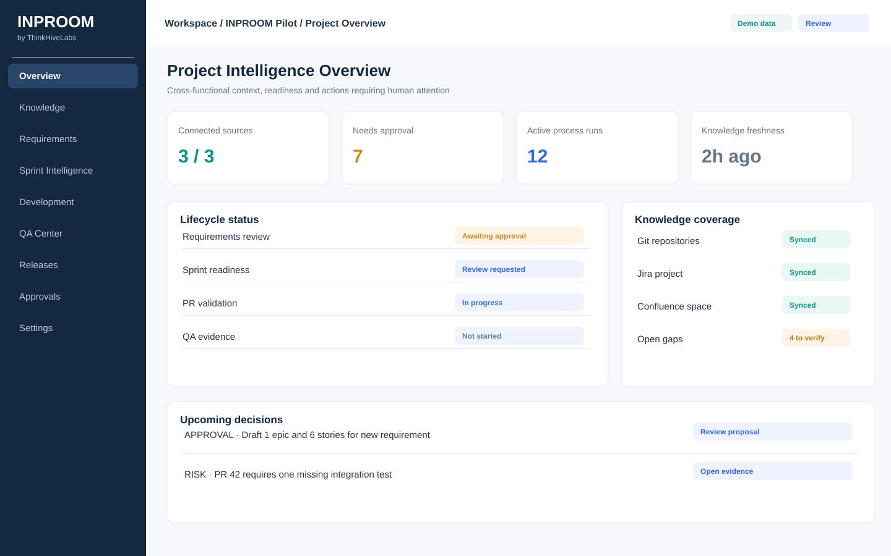
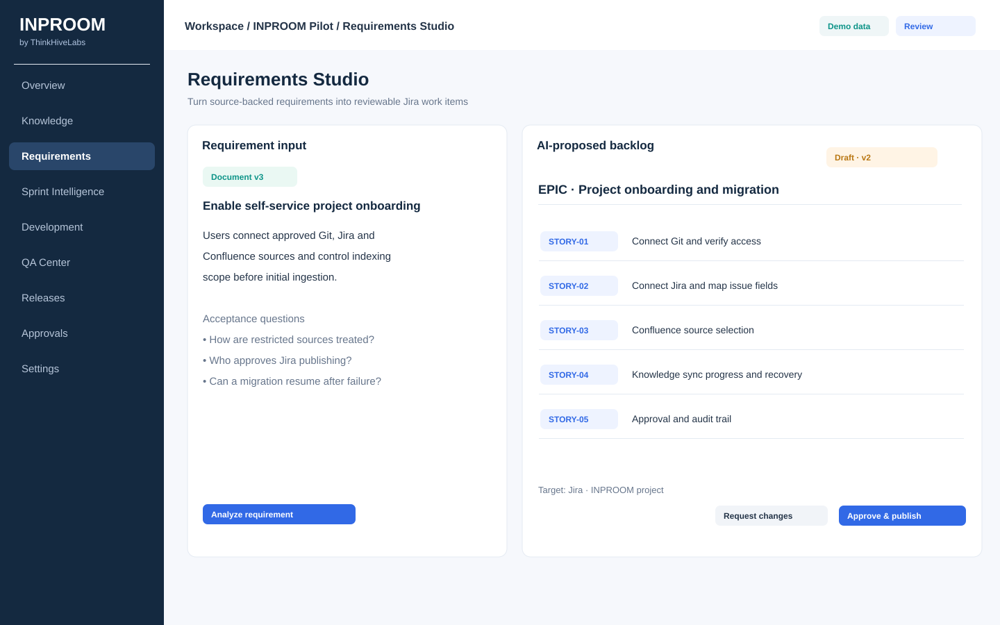
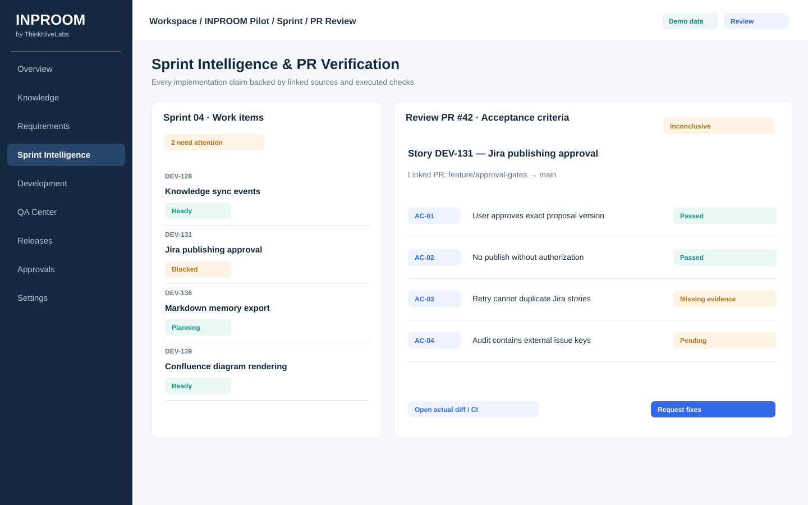
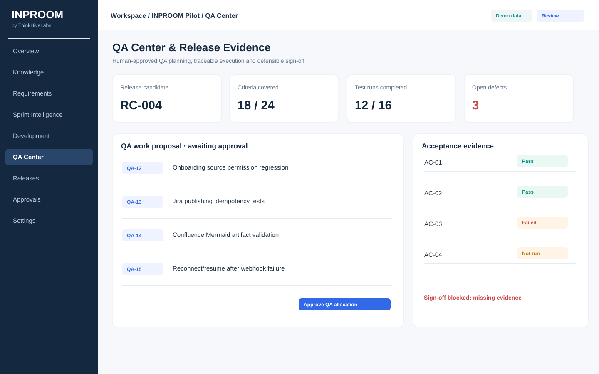

# INPROOM — Visual UI Concepts

Editable SVG screen concepts for early design review. They are **not screenshots of a working product**.

| Concept | Purpose | Preview |
|---|---|---|
| Project Overview | Executive orientation, source health, approvals |  |
| Requirements Studio | Requirement → draft epic/stories → approval |  |
| Sprint & PR Review | Implementation readiness and criterion-based verification |  |
| QA Center | Release candidate coverage, QA planning and test evidence |  |

**Figma handoff:** Import each SVG into Figma to edit vector shapes, labels and hierarchy. SVG import does not automatically recreate a responsive component system or an original native Figma design file. The [design blueprint](../README.md) contains the proposed tokens and interaction specifications. The [HTML review prototype](../prototype/index.html) provides simple tab switching; it has no GitHub/Jira/Confluence access.

All numbers and work-item labels shown in the visuals are **illustrative mock data**, not product metrics or live connector results.
